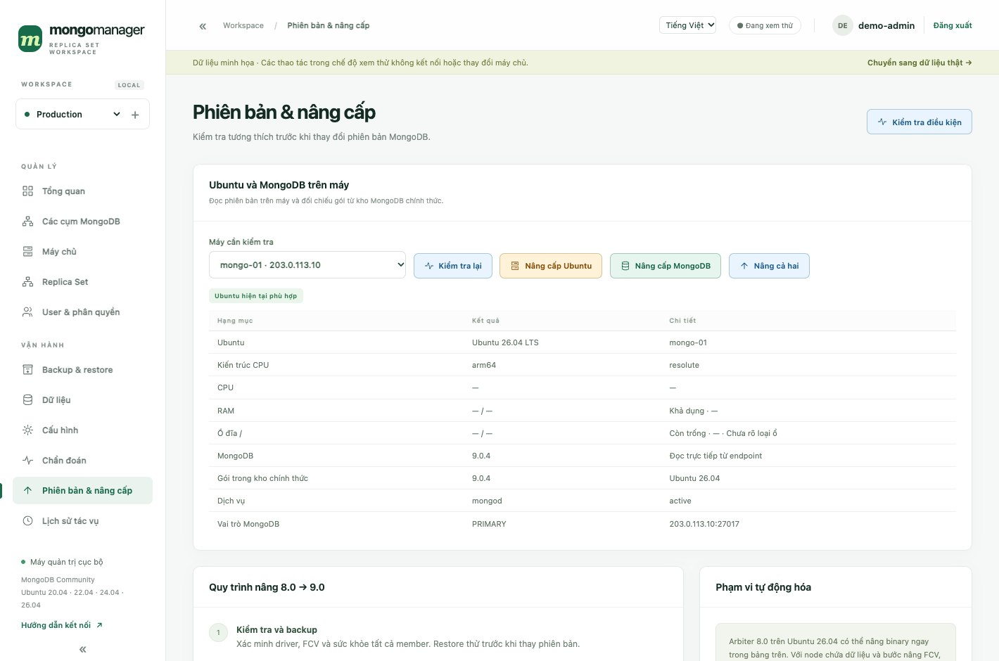
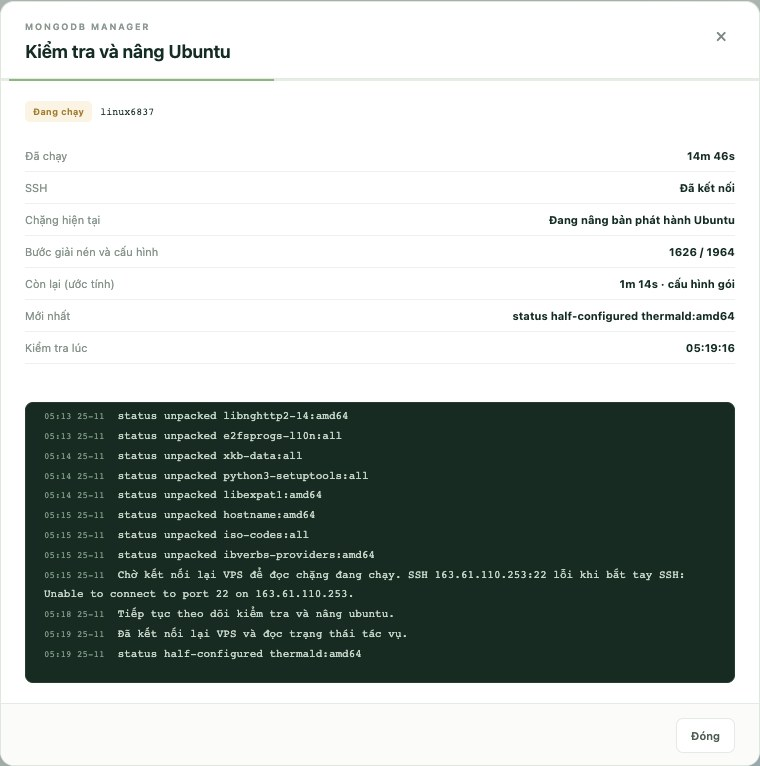

# MongoDB Manager

Quản trị MongoDB Community trên VPS Ubuntu từ một giao diện web tiếng Việt hoặc tiếng Anh. Mỗi workspace tương ứng với một cụm. Manager kết nối MongoDB để đọc dữ liệu và quản lý replica set. Khi cần cài gói, điều khiển dịch vụ hoặc đọc nhật ký, Manager dùng SSH của VPS được chọn.

[Chạy Manager](#quickstart) · [Kết nối cụm có sẵn](#connect) · [Dựng cụm mới](#bootstrap) · [Thêm Secondary](#secondary) · [Backup và restore](#backup)

<a id="quickstart"></a>

## Chạy Manager và đăng nhập

Trên máy cá nhân hoặc VPS quản trị có Git, Python 3.10 trở lên, pip và venv, chạy:

```bash
git clone https://github.com/manhgdev/setup_mongodb_replica.git
cd setup_mongodb_replica
bash start-web.sh
```

Mở [127.0.0.1:8765](http://127.0.0.1:8765) trên máy đang chạy Manager. Lần đầu, tạo tài khoản quản trị và lưu mã khôi phục. Manager tự đăng nhập. Chọn **Xem thử giao diện** để khám phá cụm minh họa trong ảnh dưới đây.


<details>
<summary>Chạy nền bằng PM2, truy cập từ xa và khôi phục tài khoản</summary>

Nếu đang chạy bằng terminal, chờ các tác vụ kết thúc rồi nhấn `Ctrl+C`. Từ thư mục dự án, dùng:

```bash
pm2 start pm2.start.json
pm2 status mongodb-manager
pm2 logs mongodb-manager
```

Sau khi cập nhật backend, chờ tác vụ đang chạy hoàn tất rồi dùng `pm2 restart mongodb-manager`. Để triển khai bằng systemd hoặc mở qua tên miền HTTPS, xem [hướng dẫn triển khai](README_WEB.md) và [cấu hình mẫu](deploy/).

Bấm avatar để sửa tài khoản web. Nếu mất mật khẩu, chọn **Quên mật khẩu?** và nhập mã khôi phục. Popup cũng có hướng dẫn đặt lại từ terminal trên máy quản trị khi mất mã.

</details>

## Từ VPS đến replica set

<a id="connect"></a>

### Đã có cụm đang chạy

1. Mở **Các cụm MongoDB → Thêm cụm**. Nhập endpoint của một primary hoặc secondary, tài khoản MongoDB và database xác thực.
2. Bấm **Kiểm tra & lưu cụm**. Mở **Tổng quan** và đối chiếu tên replica set, địa chỉ các member và primary hiện tại.
3. Để quản trị dịch vụ trên một member, bấm node trên sơ đồ rồi cấu hình SSH cho VPS đó. Hồ sơ SSH gắn với máy nên vẫn sử dụng được sau khi cụm bầu primary mới.

<a id="bootstrap"></a>

### Có một VPS trắng và muốn dựng cụm

1. Trong **Máy chủ**, thêm IP public, cổng SSH và tài khoản VPS. Mật khẩu SSH là phương thức mặc định, có thể chọn key/agent. Tác vụ cài đặt cần root hoặc quyền sudo phù hợp.
2. Chọn **VPS mới → Cụm mới**. Chọn nhánh MongoDB, cổng, tên replica set và tài khoản quản trị database sẽ được tạo.
3. Xem kế hoạch rồi thực hiện. Manager cài gói, tạo keyfile, cấu hình dịch vụ và khởi tạo replica set. Khi **Tổng quan** hiện một member **PRIMARY**, cụm đã sẵn sàng để thêm Secondary.

<a id="secondary"></a>

### Muốn thêm một VPS làm Secondary

Mở đúng workspace. Nếu đã lưu hồ sơ máy, bấm **Thêm làm Secondary** trên dòng VPS đó. Nếu chưa có hồ sơ, mở **Replica Set → Thêm Secondary**. Chọn cách xử lý theo trạng thái thực tế của cổng MongoDB trên VPS đích:

| VPS đích | Chọn trong Manager |
| --- | --- |
| Chưa cài MongoDB hoặc có cổng trống | **Chuẩn bị qua SSH**. Manager kiểm tra phiên bản, lấy keyfile từ primary hiện tại và chuẩn bị instance trên VPS đích. Cả hai máy cần có hồ sơ SSH. |
| Đã chạy đúng replica set và keyfile | **Thêm qua MongoDB**. Nhập endpoint của node đã chuẩn bị và dùng tài khoản quản lý cụm. |
| Standalone trống đang giữ cổng cần dùng | Trong luồng SSH, chọn **Dừng standalone trống để dùng lại cổng**. Manager kiểm tra PID, listener loopback, database và nhánh phiên bản trước khi dừng service cũ. Instance mới có thư mục dữ liệu riêng. |

Kiểm tra **Votes** và **Ưu tiên bầu primary** trước khi xác nhận. Secondary mới mặc định là **1 / 1**. Theo dõi tác vụ đến khi node đạt **SECONDARY**. Nếu tác vụ báo member đã được thêm và đang đồng bộ, mở **Replica Set** để theo dõi tiến độ.

## Quản trị hằng ngày

| Muốn làm gì? | Mở ở đâu? |
| --- | --- |
| Xem topology, độ trễ và vai trò | **Tổng quan**. Bấm node để mở đúng VPS. Nhấp đúp tên để đổi nhãn hiển thị. |
| Thêm arbiter, sửa Votes hoặc ưu tiên, bàn giao primary | **Replica Set**. Trong **Step down Primary**, chọn secondary đủ điều kiện hoặc để MongoDB tự bầu. |
| Kiểm tra VPS, đọc journal, xử lý lỗi khởi động | **Máy chủ → Dịch vụ**. Manager kiểm tra trạng thái systemd, PID và cổng của instance đã chọn. |
| Gỡ node hoặc xóa hồ sơ VPS | **Gỡ** kiểm tra quorum, dừng dịch vụ và gỡ membership, giữ hồ sơ SSH cùng dữ liệu. **Xóa** bỏ hồ sơ quản trị sau khi kiểm tra dịch vụ. |
| Xem hoặc sửa document | **Dữ liệu → database → collection**. Bấm vào giá trị để sửa, kể cả trường con, rồi bấm **Lưu**. Có bộ lọc, phân trang và chế độ Extended JSON. |
| Quản lý tài khoản database | **User & phân quyền**. Chọn database xác thực và role. Tài khoản đăng nhập web được quản lý riêng qua avatar. |

<details>
<summary>Xem ảnh trang Máy chủ</summary>


</details>

<a id="backup"></a>

## Backup và restore

**Máy lưu backup** là nơi chạy Database Tools và giữ archive tại `/var/backups/mongodb-manager`. **Đích restore** là MongoDB nhận dữ liệu. Hai nơi này có thể nằm trên hai VPS khác nhau.

1. **Tạo bản sao.** Trong workspace nguồn, mở **Backup & restore**, chọn máy lưu và phạm vi. Có thể chọn toàn replica set kèm oplog, tất cả database ứng dụng, các database cụ thể hoặc từng collection. Các database chọn riêng được dump tuần tự.
2. **Kiểm tra bản sao.** Trong **Các bản backup**, đối chiếu ID, thời điểm, nguồn và phạm vi. Bấm **Xem dữ liệu** để duyệt collection trong archive.
3. **Khôi phục.** Bấm **Restore** trên dòng bản sao, chọn cụm đích hoặc một endpoint standalone có thể ghi. Khi chọn thay thế collection, kiểm tra kỹ database và đích nhận trước khi thực hiện.
4. **Lặp lại theo lịch.** Mở **Lịch backup**, chọn phạm vi và giờ chạy. Ví dụ cron `0 2 * * *` chạy lúc 02:00 hằng ngày theo giờ Việt Nam khi Manager đang hoạt động. **Đồng bộ ngay** tạo backup mới rồi restore một lần vào cụm độc lập.

## Kiểm tra phiên bản và nâng cấp

Vào **Phiên bản & nâng cấp**, chọn VPS và bấm **Kiểm tra lại**. Kết quả SSH và MongoDB xuất hiện theo từng phần. Đọc cột **Chi tiết** để biết phiên bản đến từ endpoint, binary trên máy hay nhánh dự định cài. Bảng cũng hiển thị mức sử dụng CPU, RAM và ổ gốc của VPS.

Ba nút **Nâng cấp Ubuntu**, **Nâng cấp MongoDB** và **Nâng cả hai** mở kế hoạch cho máy đã chọn. Trước khi nâng node chứa dữ liệu, kiểm tra quorum và chuẩn bị bản backup đã thử restore. Theo dõi bước cài gói, reboot và kiểm tra sau nâng cấp trong **Lịch sử tác vụ**.

<details>
<summary>Xem ảnh chọn VPS và ba thao tác nâng cấp</summary>



</details>

## Vận hành Manager

- **Chuyển máy quản trị.** Sao lưu toàn bộ `.web-data/`, hoặc thư mục cấu hình qua `MONGO_MANAGER_DATA`, gồm cơ sở dữ liệu và khóa mã hóa. Archive của các cụm được lưu riêng trên máy thực thi backup.
- **Đóng gói.** Chạy `bash package-web.sh` để tạo `dist/mongodb-manager-web.tar.gz`. Các bước cấu hình domain, HTTPS và service có trong [hướng dẫn triển khai](README_WEB.md).
- **Kiểm thử.** Sau khi tạo môi trường Python, chạy `.venv/bin/python -m pytest -q`. Xem [nhật ký kiểm chứng](WEB_VALIDATION.md) để biết phạm vi đã thử trên máy thật hoặc VM.
- **Dùng terminal.** Bộ script Bash bắt đầu tại [menu.sh](menu.sh). Luồng ghép node bằng dòng lệnh được mô tả trong [hướng dẫn join replica set](README_JOIN_REPLICA.md).

Trong bảng theo dõi Ubuntu, dòng **SSH** hiển thị lần thử kết nối gần nhất khi VPS tạm ngắt. Khi kết nối lại, bảng cập nhật chặng và tiến độ, còn nhật ký giữ thời điểm ngắt để đối chiếu.



## Cập nhật tài liệu

Cập nhật mục hướng dẫn liên quan trong cùng thay đổi mã nguồn. Khi giao diện thay đổi, chụp ảnh bằng workspace minh họa, lưu trong [previews/](previews/) và dùng liên kết tương đối để GitHub hiển thị ảnh.
