# MongoDB Manager và ZM VPS Manager

Chạy `bash start-web.sh` để mở **MongoDB Manager** tại [trang chính](http://127.0.0.1:8765/) và **ZM VPS Manager** tại [trang VPS](http://127.0.0.1:8765/vps/). Nhấn **ZM VPS Manager ↗** trên thanh trên cùng để chuyển sang VPS. Nhấn **← MongoDB Manager** để quay về màn hình MongoDB trước đó, trên cả máy tính và điện thoại. Hai giao diện dùng chung tài khoản quản trị, hồ sơ máy và lịch sử tác vụ.

Mở trực tiếp một tab VPS hoặc MongoDB khi chưa đăng nhập sẽ đưa bạn đến cùng trang `/login`. Sau khi khởi tạo tài khoản `admin` đầu tiên, hệ thống hỗ trợ **đăng ký & đăng nhập đa người dùng** với 3 vai trò phân quyền: **Admin** (`admin` — quản lý toàn bộ tài khoản, bật/tắt tự đăng ký và chuyển workspace), **Quản trị** (`manager` — quản lý các tài khoản `user` cấp dưới), và **User** (`user` — tự đăng ký trên `/login` hoặc được tạo bởi Admin/Quản trị). Mỗi người dùng sở hữu một **không gian lưu trữ và xử lý riêng** (`manager.sqlite3`, `secret.key`, `storage_config.json`, SSH keys độc lập theo từng workspace). Khi dùng backend **MongoDB**, khóa mã hóa (`_zm_meta.cipher_key`) cùng mật khẩu SSH, tài khoản OCI và các file SSH key/PEM đã nhập (`db://ssh-keys/<id>`) đều được mã hóa Fernet và đồng bộ trực tiếp trong MongoDB để mọi máy chủ mới tự giải mã mà không lưu file key cố định trên ổ đĩa. Admin và Quản trị mặc định làm việc trên workspace riêng của mình và có thể mở workspace của user cấp dưới từ popup **Quản lý người dùng**. Nhấn tên tài khoản trên thanh trên cùng để đổi thông tin cá nhân. Nút **Xem thử giao diện** có ở cả hai ứng dụng và giữ lựa chọn khi chuyển qua lại. Trong VPS Manager, chế độ này dùng máy, gói và website mẫu. [Trang đăng nhập chung](previews/vps-manager/shared-login.jpg) · [Quên mật khẩu (User / Admin)](previews/vps-manager/forgot-password-split.jpg) · [Quản lý người dùng & phân quyền](previews/mongodb-manager/user-management.jpg) · [Chế độ xem thử VPS](previews/vps-manager/account-preview.jpg).

- [Tài liệu MongoDB Manager](apps/mongodb_manager/docs/README.md)
- [Tài liệu ZM VPS Manager](apps/vps_manager/docs/README.md)

Trang **Tổng quan VPS** hiển thị tải CPU trung bình trong 1, 5 và 15 phút, RAM đang dùng, dung lượng phân vùng gốc, kernel và thời gian chạy tại lần kiểm tra gần nhất. Bên dưới là website theo hạn chứng chỉ, năm tác vụ gần nhất có thể bấm để xem log và phiên bản phần mềm phát hiện trong bộ cài. Bấm **Làm mới** để đọc lại tài nguyên.

Trong **Tổng quan VPS**, nhập **Hostname mới**, bấm **Đổi hostname** và xác nhận tên cũ → tên mới. Manager dùng `hostnamectl`, đồng bộ `/etc/hosts` và ghi `preserve_hostname: true` vào `/etc/cloud/cloud.cfg.d/zz-zm-manager-hostname.cfg`. Khi xác minh thành công, tên mới xuất hiện ngay trên trang. Lịch sử tác vụ ghi tài khoản quản trị, máy đích, tên cũ, tên mới và kết quả. Địa chỉ kết nối SSH và tên hồ sơ VPS được giữ nguyên. [Ảnh xác nhận đổi hostname](previews/vps-manager/hostname-confirm.jpg).

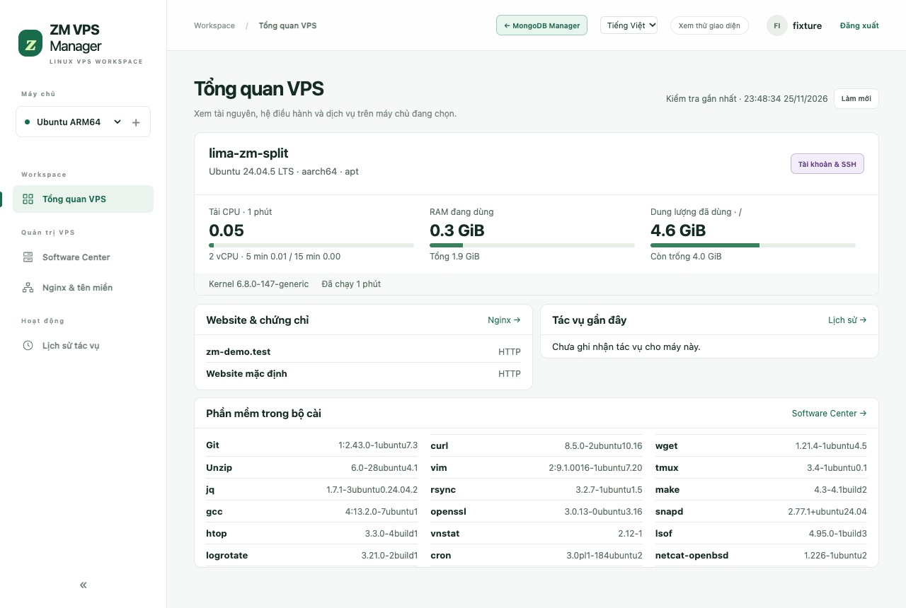

Trong **Nginx & tên miền**, chọn VPS và bấm trực tiếp các nút sửa, bật, tắt hoặc xóa trên dòng website. Các nút hiển thị theo trạng thái và cấu hình của site. **Cấp SSL** hỗ trợ Certbot HTTP-01 và Cloudflare DNS-01. [Xem giao diện quản lý tên miền](previews/vps-manager/nginx-direct-actions.jpg).

**VPS mới chỉ có SSH key:** chọn **Thêm VPS**, nhập user của image (ví dụ `ubuntu` hoặc `opc`), chọn **SSH key** và đường dẫn private key trên máy chạy Manager. Bấm **Kiểm tra kết nối**, đối chiếu fingerprint với console VPS rồi xác nhận tin cậy. Trong **Tổng quan VPS → Tài khoản & SSH**, đặt mật khẩu Linux cho user đang kết nối. Chỉ đánh dấu tùy chọn SSH bằng mật khẩu khi muốn mở phương thức đăng nhập này. [Ảnh quản lý tài khoản](previews/vps-manager/account-ssh.jpg).

**Software Center** gồm 4 tab thống nhất ngay trên thanh công cụ: **Bộ cài của tôi** (10 bộ cài chọn sẵn và mục **Tất cả** đã ẩn các gói phụ thuộc nội bộ), **Dịch vụ** (liệt kê systemd service/timer đang chạy, trạng thái tự khởi động, RAM/PID và cho phép bật/tắt/khởi động lại), **Gói hệ điều hành** (đọc toàn bộ dpkg/RPM) và **Kho phần mềm** (tìm và xem trước kế hoạch cài gói ngoài bộ cài), kèm nút **Bảo trì gói**. Mỗi bộ hiển thị số mục đạt trên tổng số của VPS đang chọn. Dùng bộ lọc để xem phần còn thiếu hoặc chưa xác minh. **Tiếp tục →** kiểm tra trực tiếp các máy đã chọn, hiển thị phụ thuộc rồi đưa các máy cần cài vào hàng đợi. [Ảnh bộ Docker trên Ubuntu](previews/vps-manager/software-my-kits.jpg).

**Docker & Compose** quản lý container qua daemon cục bộ của VPS. Tab **Đóng gói & Di chuyển** (mặc định) cho phép quét các app **PM2**, **Docker Compose**, cấu hình **Nginx + SSL** và dữ liệu **MongoDB** (`mongodump --gzip`) trên VPS đang chạy để đóng gói thành 1 file `.tar.gz`, tải về hoặc tải lên 1 lần để tự động cài phần mềm thiếu, khôi phục dữ liệu MongoDB, dựng lại ứng dụng và nạp Nginx/SSL trên bất kỳ VPS mới nào. Tab **Container** hiển thị tên, image, cổng, trạng thái, 200 dòng log gần nhất và nút Start/Stop/Restart. Tab **Compose** nhận đường dẫn tuyệt đối đến file YAML trên VPS, kiểm tra cấu hình và cho xem project, service, image trước khi xác nhận triển khai. [Hướng dẫn chi tiết Docker & Di chuyển VPS](apps/vps_manager/docs/README.md#docker--compose) · [Ảnh container thực tế](previews/vps-manager/docker-containers.jpg).

**Firewall** quản lý hai lớp trong một bảng: Ubuntu UFW và Oracle Cloud (Security List/NSG). Bảng hiển thị port LISTEN (tiến trình), truy cập nội bộ, kết nối bên ngoài từ máy chạy Manager (TCP), trạng thái UFW và Oracle, đồng thời cảnh báo port UFW đã mở nhưng Oracle Cloud còn chặn. **Mở port** hỗ trợ port đơn hoặc dải (`8000-8100`), TCP/UDP, Source CIDR và chọn UFW, Oracle Cloud hoặc cả hai; rule đã được bao phủ thì bỏ qua, rule hiện có không bị ghi đè, port SSH không thể đóng. VPS thường chỉ dùng lớp UFW. Oracle Cloud được nhận diện qua Instance Metadata; vào **Cấu hình Oracle Cloud** để thêm tài khoản (API Key hoặc Instance Principal), kiểm tra kết nối, chọn region và liên kết với VPS. Dùng OCI Python SDK (`oci`), không cần OCI CLI. Private key được mã hóa trong kho dữ liệu, không trả lại giao diện và không ghi log. Policy IAM tối thiểu cho compartment của VPS: `read instance-family`, `read virtual-network-family`, `manage security-lists`, `manage network-security-groups`. Instance Principal chỉ dùng khi chính Manager chạy trên VM Oracle thuộc Dynamic Group. Tiến trình và kết quả từng lớp nằm trong **Lịch sử tác vụ**. Ảnh preview sẽ bổ sung trong `previews/vps-manager/`.

**Git & SSH Key** hiển thị phiên bản Git, OpenSSH Client, danh tính Git và các public key của tài khoản Linux trên VPS đang chọn. Tạo key ED25519 hoặc RSA 4096-bit, mở **Public key → Sao chép**, thêm vào tài khoản Git, rồi bấm **Kiểm tra kết nối**. Dùng **+ Alias** để chọn key riêng theo tài khoản, ví dụ `git clone git@github-work:nhom/project.git`. [Ảnh quản lý Git & SSH Key](previews/vps-manager/git-ssh-keys.jpg) · [Hướng dẫn sử dụng](apps/vps_manager/docs/README.md#git--ssh-key).

**SSH Terminal** mở phiên SSH tương tác nhiều tab ngay trên trình duyệt bằng `xterm.js` + WebSocket PTY, hỗ trợ truecolor, ký tự box-drawing (`btop`, `htop`), con trỏ khối rõ nét và giải mã UTF-8 theo luồng để không lỗi ký tự khi truyền qua chunk. Hỗ trợ **chia khung nhiều VPS (Split-pane)** qua **+ Mở nhiều VPS** hoặc **+ Chia vào tab này**, kéo thả tiêu đề khung để chia/đổi vị trí, kéo thanh chia để đổi kích thước, phóng to từng khung và bật **Broadcast** để gõ lệnh đồng thời lên nhiều VPS. [Ảnh SSH Terminal chạy btop](previews/vps-manager/ssh-terminal-btop.png) · [Ảnh SSH Terminal nhiều VPS + Broadcast](previews/vps-manager/ssh-terminal-multi.png).

**SFTP** cung cấp trình quản lý và truyền file 2 khung song song (phong cách Termius) nhiều tab ngay trên trình duyệt: mỗi khung kết nối độc lập tới bất kỳ VPS nào trong workspace để **chép/di chuyển file trực tiếp giữa 2 VPS**, kéo-thả hoặc tải lên/tải xuống từ máy tính cá nhân (hỗ trợ nén `.tar.gz` khi tải thư mục hoặc nhiều mục), tạo file/thư mục, đổi tên, phân quyền `chmod` (ma trận rwx + mã octal), sửa file text trực tiếp và theo dõi tiến trình ở **Hàng đợi truyền file**. Có nút **SFTP** trên từng khung **SSH Terminal** để mở nhanh. [Ảnh SFTP 2 khung song song](previews/vps-manager/sftp-dual-pane.png).

Sidebar VPS chia theo workspace, quản trị và hoạt động. Trên desktop, nút « thu gọn sidebar thành dải biểu tượng và lưu lựa chọn cho lần mở sau.

Trong **Software Center → Bộ cài của tôi → Tiếp tục** hoặc **Nginx & tên miền → + Thêm tên miền**, đánh dấu các **Máy chủ đích** để cài cùng bộ gói hoặc tạo cùng một website trên nhiều VPS. **Lịch sử tác vụ → Tác vụ nhiều máy** hiển thị kết quả riêng và mở log theo máy. [Ảnh chọn máy đích](previews/vps-manager/multi-targets.jpg).

Ngay trên dòng website HTTPS đang bật, chọn **Gia hạn SSL** để chạy Certbot cho các chứng chỉ đang được site sử dụng (hỗ trợ cả `ssl_certificate` qua `include`, symlink/archive và đối chiếu trực tiếp từ `/etc/letsencrypt/renewal/*.conf`; nếu site được chép từ VPS khác và chưa có hồ sơ `/etc/letsencrypt/renewal`, nút **Cấp SSL** vẫn hiển thị để cấp lại hồ sơ Certbot mới trên VPS đích), hoặc **Thử gia hạn** (`--dry-run`) cho cả site do Manager quản lý lẫn site import từ ngoài. Thanh công cụ **Nginx & tên miền** hiển thị dải trạng thái **Tự gia hạn SSL** (hỗ trợ `certbot.timer`, `certbot-renew.timer`, `snap.certbot.renew.timer` với `RandomizedDelaySec` hoặc cron `/etc/cron.d/zm-certbot-renew` tự giãn cách ngẫu nhiên giờ/phút giữa các VPS để tránh đụng độ cùng thời điểm), nút **Token Cloudflare** để đẩy/cập nhật API token DNS-01 (`/etc/letsencrypt/zm-credentials/*.ini`, quyền `0600`) đồng loạt cho tất cả hoặc các VPS đã chọn (lưu mã hóa theo workspace), cho phép **Bật tự gia hạn SSL** hoặc **Thử gia hạn SSL** toàn bộ chứng chỉ, đồng thời tự động bật gia hạn định kỳ ngay sau khi **Cấp SSL** thành công. Khi dùng **Copy giữa các VPS**, có thể bật tùy chọn **Tự tạo hồ sơ tự gia hạn Certbot (Cloudflare DNS-01)** để tự động đẩy token đã lưu, cấp hồ sơ `renewal` và bật tự gia hạn trên VPS đích chỉ trong 1 lần bấm. Popup hiển thị tên hồ sơ Certbot trước khi chạy. [Ảnh nút gia hạn](previews/vps-manager/nginx-renew.jpg).

Mỗi file cấu hình chiếm một dòng trong danh sách website. Các tuyến HTTP chuyển hướng và HTTPS reverse proxy cùng file hiển thị chung một bộ nút thao tác. [Ảnh website có hai tuyến](previews/vps-manager/nginx-file-routes.jpg). Trên desktop, tên miền và file cấu hình, định tuyến và nhóm thao tác nằm ở ba cột thẳng hàng. Trên điện thoại, các nút nằm ngay dưới thông tin site. Giao diện đặt trạng thái cạnh tên miền, phân biệt HTTP/HTTPS bằng nhãn màu và dùng nút pastel theo thao tác. **Chi tiết website** mở cấu hình Nginx hiện có trên máy, diff trước khi áp dụng, bản sao để rollback, trạng thái SSL và nhật ký. [Ảnh nhãn và nút thao tác](previews/vps-manager/nginx-actions.jpg) · [Ảnh danh sách website](previews/vps-manager/nginx-inventory.jpg) · [Hướng dẫn Nginx](apps/vps_manager/docs/README.md#website-đã-có-trên-vps).

[Giao diện VPS trên điện thoại](previews/vps-manager/mobile.jpg)

Quản trị MongoDB Community trên VPS Ubuntu từ một giao diện web tiếng Việt hoặc tiếng Anh. Mỗi workspace tương ứng với một cụm. Manager kết nối MongoDB để đọc dữ liệu và quản lý replica set. Khi cần cài gói, điều khiển dịch vụ hoặc đọc nhật ký, Manager dùng SSH của VPS được chọn.

[Tra cứu chức năng theo màn hình](#manual) · [Chạy Manager](#quickstart) · [Kết nối cụm có sẵn](#connect) · [Dựng cụm mới](#bootstrap) · [Thêm Secondary](#secondary) · [Backup và restore](#backup)

<a id="quickstart"></a>

## Chạy Manager và đăng nhập

Trên máy cá nhân hoặc VPS quản trị có Git, Python 3.10 trở lên, pip và venv, chạy:

```bash
git clone https://github.com/manhgdev/setup_mongodb_replica.git
cd setup_mongodb_replica
bash start-web.sh
```

Mở [127.0.0.1:8765](http://127.0.0.1:8765) trên máy đang chạy Manager. Lần đầu, tạo tài khoản quản trị và lưu mã khôi phục. Manager tự đăng nhập. Chọn **Xem thử giao diện** để khám phá cụm minh họa trong ảnh dưới đây.

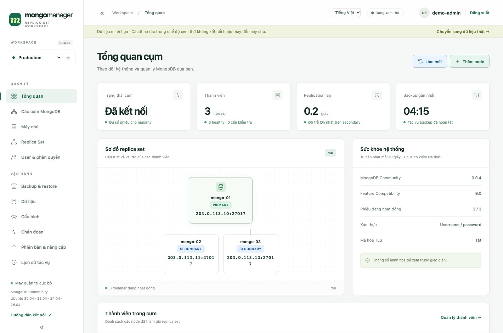

Trên điện thoại, bấm **☰** cạnh tên màn hình để mở menu. Các nút ngôn ngữ, xem thử và tài khoản nằm ở hàng bên dưới.

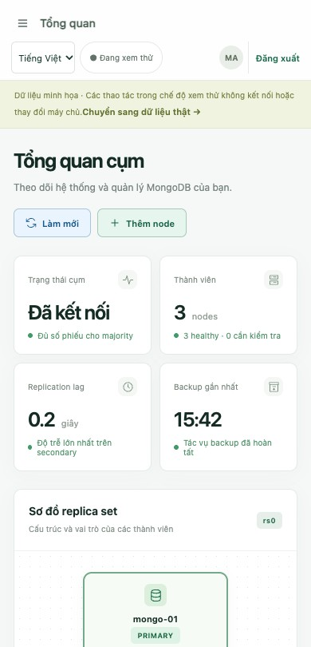

<details>
<summary>Chạy nền bằng PM2, truy cập từ xa và khôi phục tài khoản</summary>

Nếu đang chạy bằng terminal, chờ các tác vụ kết thúc rồi nhấn `Ctrl+C`. Từ thư mục dự án, dùng:

```bash
pm2 start pm2.start.json
pm2 status mongodb-manager
pm2 logs mongodb-manager
```

Sau khi cập nhật backend, chờ tác vụ đang chạy hoàn tất rồi dùng `pm2 restart mongodb-manager`. Để triển khai bằng systemd hoặc mở qua tên miền HTTPS, xem [hướng dẫn triển khai](README_WEB.md) và [cấu hình mẫu](deploy/).

Bấm avatar để sửa tài khoản web. Nếu mất mật khẩu, chọn **Quên mật khẩu?** và nhập mã khôi phục. Popup cũng có hướng dẫn đặt lại từ terminal trên máy quản trị khi mất mã.

</details>

## Từ VPS đến replica set

<details>
<summary>Đăng nhập, thiết lập ban đầu và quản trị tài khoản</summary>

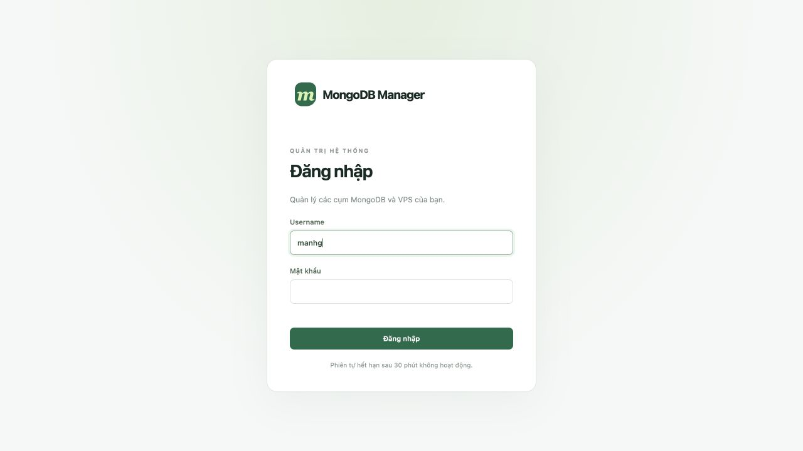

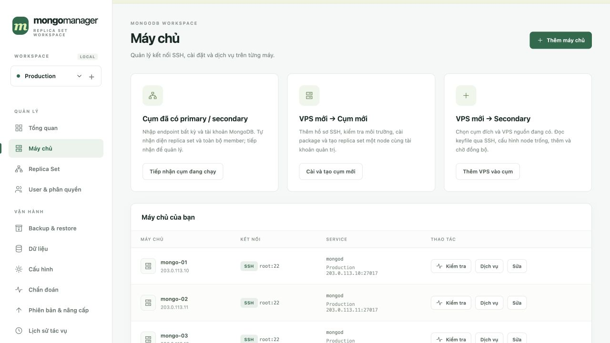

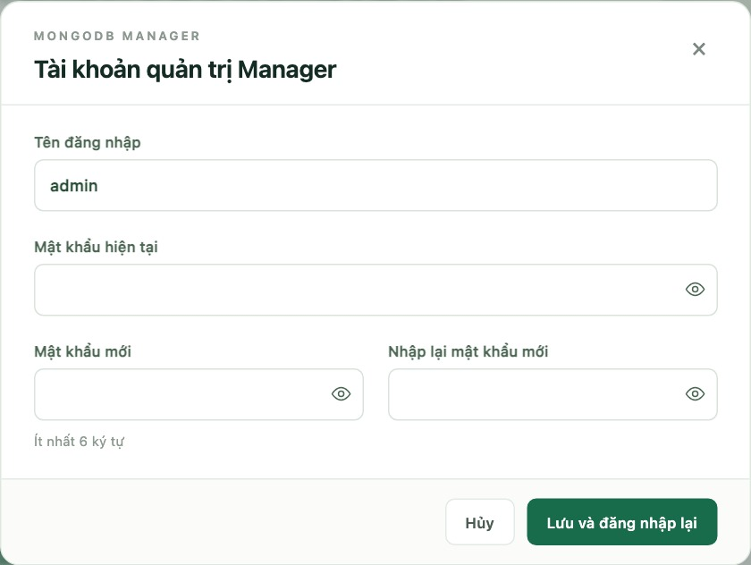

</details>

<a id="connect"></a>

### Đã có cụm đang chạy

1. Mở **Các cụm MongoDB → Thêm cụm**. Nhập endpoint của một primary hoặc secondary, tài khoản MongoDB và database xác thực.
2. Bấm **Kiểm tra & lưu cụm**. Mở **Tổng quan** và đối chiếu tên replica set, địa chỉ các member và primary hiện tại.
3. Để quản trị dịch vụ trên một member, bấm node trên sơ đồ rồi cấu hình SSH cho VPS đó. Hồ sơ SSH gắn với máy nên vẫn sử dụng được sau khi cụm bầu primary mới.

<a id="bootstrap"></a>

### Có một VPS trắng và muốn dựng cụm

1. Trong **Máy chủ**, thêm IP public, cổng SSH và tài khoản VPS. Mật khẩu SSH là phương thức mặc định, có thể chọn key/agent. Tác vụ cài đặt cần root hoặc quyền sudo phù hợp.
2. Chọn **VPS mới → Cụm mới**. Chọn nhánh MongoDB, cổng, tên replica set và tài khoản quản trị database sẽ được tạo.
3. Xem kế hoạch rồi thực hiện. Manager cài gói, tạo keyfile, cấu hình dịch vụ và khởi tạo replica set. Khi **Tổng quan** hiện một member **PRIMARY**, cụm đã sẵn sàng để thêm Secondary.

<a id="secondary"></a>

### Muốn thêm một VPS làm Secondary

Mở đúng workspace. Nếu đã lưu hồ sơ máy, bấm **Thêm làm Secondary** trên dòng VPS đó. Nếu chưa có hồ sơ, mở **Replica Set → Thêm Secondary**. Chọn cách xử lý theo trạng thái thực tế của cổng MongoDB trên VPS đích:

| VPS đích | Chọn trong Manager |
| --- | --- |
| Chưa cài MongoDB hoặc có cổng trống | **Chuẩn bị qua SSH**. Manager kiểm tra phiên bản, lấy keyfile từ primary hiện tại và chuẩn bị instance trên VPS đích. Cả hai máy cần có hồ sơ SSH. |
| Đã chạy đúng replica set và keyfile | **Thêm qua MongoDB**. Nhập endpoint của node đã chuẩn bị và dùng tài khoản quản lý cụm. |
| Standalone trống đang giữ cổng cần dùng | Trong luồng SSH, chọn **Dừng standalone trống để dùng lại cổng**. Manager kiểm tra PID, listener loopback, database và nhánh phiên bản trước khi dừng service cũ. Instance mới có thư mục dữ liệu riêng. |

Kiểm tra **Votes** và **Ưu tiên bầu primary** trước khi xác nhận. Secondary mới mặc định là **1 / 1**. Theo dõi tác vụ đến khi node đạt **SECONDARY**. Nếu tác vụ báo member đã được thêm và đang đồng bộ, mở **Replica Set** để theo dõi tiến độ.

<a id="manual"></a>

## Sổ tay theo màn hình

| Trang trong thanh bên | Công việc chính |
| --- | --- |
| [Tổng quan](#overview), [Các cụm MongoDB](#clusters) | Chọn workspace, theo dõi topology, thêm hoặc chỉnh hồ sơ cụm |
| [Máy chủ](#machines), [Replica Set](#replica) | Quản trị VPS qua SSH, thêm/gỡ member, cấu hình bầu chọn và write concern |
| [User & phân quyền](#users), [Dữ liệu](#data) | Tạo tài khoản database, duyệt collection và chỉnh document |
| [Backup & restore](#backup) | Sao lưu một phần hoặc toàn cụm, duyệt archive, lập lịch và chọn đích restore |
| [Cấu hình](#settings), [Chẩn đoán](#diagnostics) | Sửa kết nối, cấu hình SSH, kiểm tra MongoDB và dịch vụ hệ điều hành |
| [Phiên bản & nâng cấp](#upgrade), [Lịch sử tác vụ](#jobs) | Kiểm tra điều kiện, chọn phạm vi nâng cấp và đọc tiến độ theo VPS |

<a id="overview"></a>

### Tổng quan

Chọn workspace ở thanh bên. Sơ đồ ở đầu README thể hiện các vai trò mà MongoDB đang báo. Bấm một node để mở đúng dòng VPS ở **Máy chủ**. Nhấp đúp tên để sửa nhãn hiển thị. Tên riêng giúp nhận diện cùng một VPS khi replica set đổi primary.

Các thẻ trạng thái, member, độ trễ và backup dẫn đến phần quản trị tương ứng. **Hoạt động gần đây** giúp mở lại tác vụ vừa chạy để xem kết quả. Khi cần xác minh sau khi thêm node, kiểm tra cả vai trò **SECONDARY** và trạng thái sức khỏe trong bảng member.

<a id="clusters"></a>

<details>
<summary>Giao diện tổng quan và trạng thái cụm</summary>

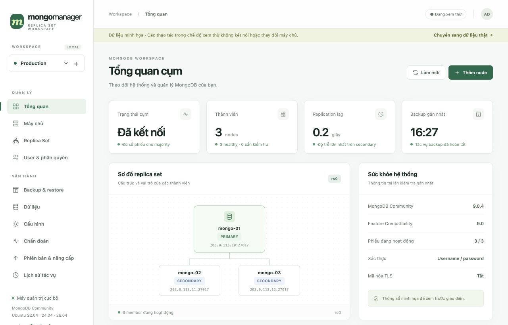

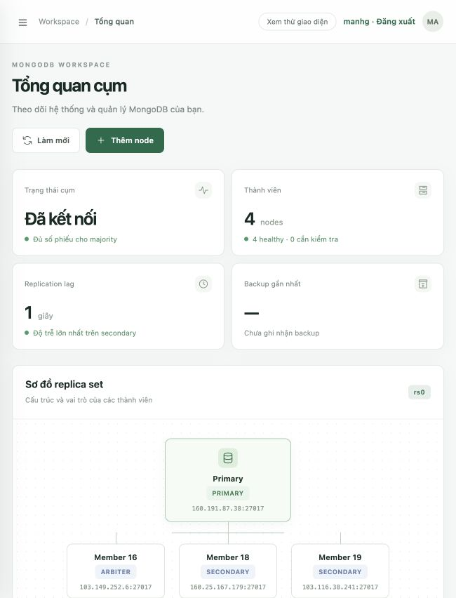

</details>

### Các cụm MongoDB

Mỗi hồ sơ lưu tên hiển thị, seed list, tên replica set, database xác thực và tùy chọn TLS. Seed có thể là địa chỉ của primary hoặc secondary. Có thể để trống tên replica set để Manager nhận diện khi kết nối. Khi bật TLS, nhập đường dẫn CA trên **máy chạy Manager** nếu cần CA riêng.

- **Kiểm tra kết nối** dùng thông tin đang nhập để thử đọc cụm. **Kiểm tra & lưu cụm** lưu hồ sơ và các liên kết VPS đã khai báo. Manager thử lấy hostname cho những máy dùng tên tự động.
- **Chỉnh kết nối** dùng khi đổi endpoint, tài khoản hoặc thiết lập TLS. **Xóa hồ sơ** bỏ kết nối đã lưu trong Manager. Để thay đổi membership thật, dùng **Gỡ** trên member của replica set.
- **SSH cho tất cả các cụm** cho phép đánh dấu những VPS thực sự dùng chung tài khoản. Việc lưu cập nhật thông tin đăng nhập của Manager. Mật khẩu Linux trên VPS chỉ thay đổi khi quản trị viên thay đổi trên chính VPS.

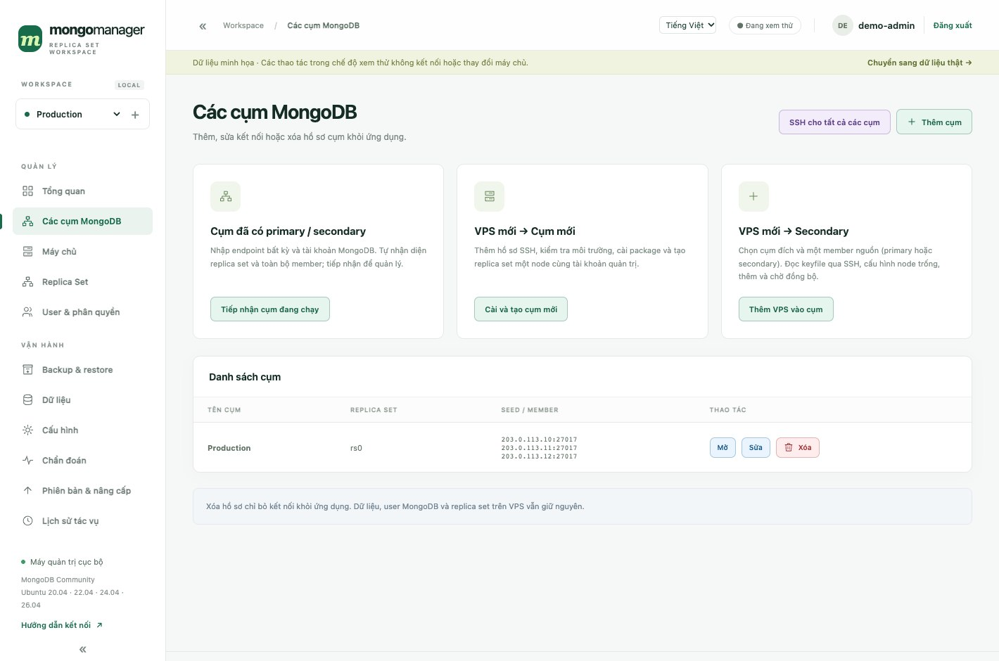

<a id="machines"></a>

### Máy chủ

Thêm VPS bằng **IP public** hoặc DNS public, **cổng MongoDB** (thường là 27017), **user SSH** và **port SSH** (thường là 22). Nếu SSH dùng hostname khác endpoint MongoDB, mở **Địa chỉ SSH riêng**. Kiểm tra **Tên service** khi một VPS có nhiều instance. Ô này phải trỏ tới systemd unit quản lý đúng tiến trình.

| Thao tác | Kết quả và điều cần kiểm tra |
| --- | --- |
| Lấy tên từ VPS | Đọc hostname qua SSH cho các máy thuộc workspace. Có thể nhập tên riêng trong **Sửa**. |
| Kiểm tra | Chạy kiểm tra môi trường trên đúng VPS của dòng đã bấm. Kết quả cho biết công cụ MongoDB và dịch vụ hiện có. |
| Đọc nhật ký | Mở journal của service trong hồ sơ. Dùng khi cài đặt, khởi động hoặc chuẩn bị node gặp lỗi. |
| Dịch vụ | Chọn khởi động, dừng, khởi động lại, bật hoặc tắt tự chạy khi boot. Dừng service sẽ ngắt các kết nối tới instance đó. |
| Thêm làm Secondary / Arbiter | Mở biểu mẫu với VPS đã chọn. Dòng máy chưa thuộc cụm nằm sau các member hiện có. |
| Gỡ | Kiểm tra quorum, xác minh tiến trình, dừng service, tắt tự khởi động và gỡ membership. Giữ hồ sơ SSH và dữ liệu để có thể thêm lại. Với primary, bàn giao vai trò trước. |
| Xóa | Xóa hồ sơ VPS khỏi Manager sau khi kiểm tra lại trạng thái dịch vụ. Dùng khi muốn bỏ máy khỏi danh sách quản trị. |

SSH hỗ trợ mật khẩu và key/agent. Với mật khẩu, Manager lưu host key ở lần kết nối đầu. Nếu khóa thay đổi, đối chiếu fingerprint từ console VPS rồi cập nhật qua **Xác minh khóa SSH**. Khi chạy Manager dưới systemd, SSH dùng home và known_hosts của tài khoản chạy dịch vụ.

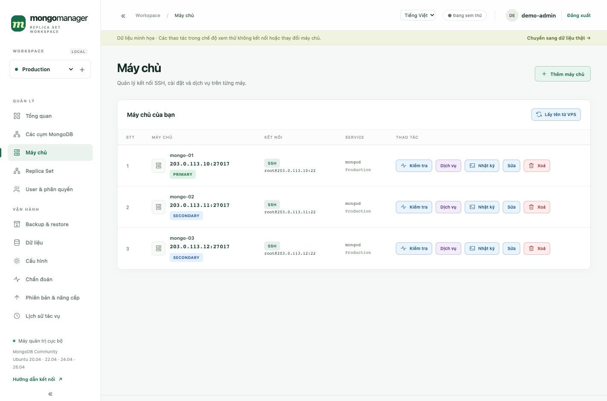

<a id="replica"></a>

### Replica Set

**PRIMARY** nhận ghi. **SECONDARY** đồng bộ dữ liệu và có thể ứng cử nếu đủ điều kiện. **ARBITER** bỏ phiếu và không lưu bản sao dữ liệu ứng dụng. Bảng **Thành viên** hiển thị endpoint và cấu hình bầu chọn để đối chiếu trước khi sửa.

- **Votes, ưu tiên, Hidden.** Votes nhận 0 hoặc 1. Ưu tiên 0 loại node khỏi danh sách ứng cử primary. Node hidden hoặc có Votes = 0 cần ưu tiên 0. Secondary mặc định Votes = 1, ưu tiên = 1. Arbiter dùng Votes = 1, ưu tiên = 0.
- **Đổi primary / Step down Primary.** Để MongoDB tự bầu hoặc chọn một secondary khỏe có quyền bỏ phiếu và ưu tiên dương. Manager kiểm tra đồng bộ và quorum trước khi bàn giao. Xem lại endpoint **PRIMARY** sau khi tác vụ kết thúc. Trong lúc bầu, ghi có thể gián đoạn ngắn.
- **Chuyển sang SECONDARY / ARBITER.** Kiểm tra endpoint và vai trò đích trong popup. Luồng chuyển vai trò dừng service trên VPS đã chọn rồi thêm lại với thư mục dữ liệu mới. Khi chuyển thành Secondary cần chờ đồng bộ ban đầu. Kiểm tra dung lượng trống trước khi chạy.
- **Write Concern.** Chọn mức xác nhận ghi mặc định của cụm. Với `w=1`, primary xác nhận ghi. Với `majority`, việc xác nhận phụ thuộc số member dữ liệu có quyền bỏ phiếu. Trong cụm một primary, một secondary và một arbiter, cả hai node dữ liệu cần sẵn sàng để xác nhận ghi majority.

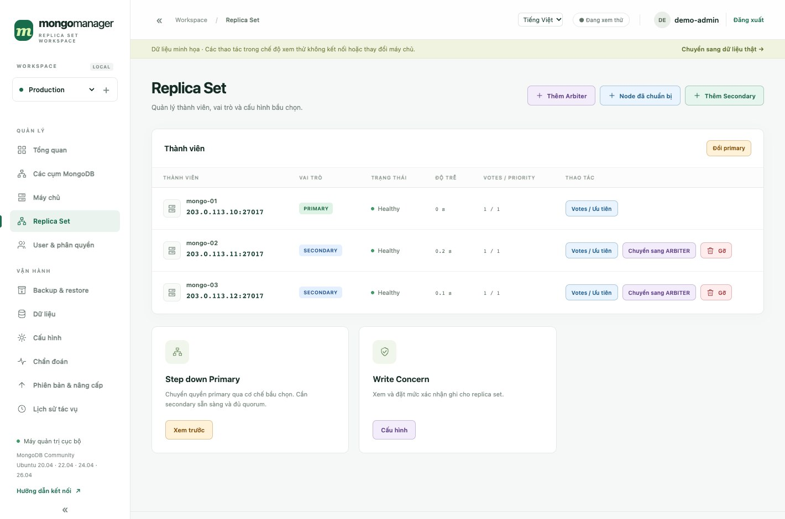

<a id="users"></a>

### User & phân quyền

**Tạo user** yêu cầu username, mật khẩu, database xác thực và role. Với tài khoản ứng dụng, chọn database ứng dụng cùng `read`, `readWrite` hoặc `dbAdmin` theo nhu cầu. Biểu mẫu dùng database `admin` cho các role `backup`, `clusterMonitor` và `root`.

Bảng định danh user bằng cả **username và database xác thực**. Bấm **Đổi mật khẩu** ở đúng dòng. Nếu đó là tài khoản kết nối hiện tại, Manager cập nhật mật khẩu hồ sơ sau khi MongoDB chấp nhận thay đổi. **Lưu mật khẩu** dành cho tài khoản đã có: nhập mật khẩu biết trước để Manager xác thực và lưu mã hóa. Biểu tượng mắt hiển thị giá trị đã lưu. **Xóa** thu hồi user trong database xác thực đã chọn.

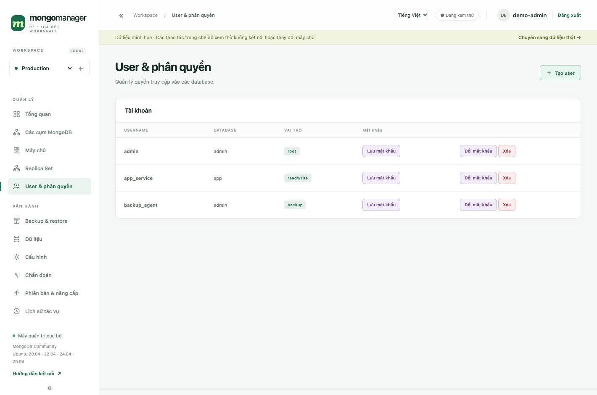

<a id="data"></a>

### Dữ liệu

1. Chọn database rồi mở **Collections**. Tìm collection bằng tên trong panel trái. Kéo đường phân cách để chỉnh chiều rộng, hoặc thu gọn panel khi cần thêm chỗ xem document.
2. Chọn **Bảng gọn** để so sánh các dòng hoặc **Chi tiết** để mở cấu trúc lồng nhau. Chọn 5, 10 hoặc 25 document mỗi trang. Có thể cuộn trong khung và dùng nút phân trang. Mở **Indexes** để xem tên và khóa index của collection.
3. Để lọc, nhập đường dẫn trường và giá trị. Ví dụ `metadata.sequence` với `42` tìm giá trị số, còn `"42"` tìm chuỗi. Với ObjectId, dùng Extended JSON, ví dụ `{"$oid":"507f1f77bcf86cd799439011"}`.
4. Mở một document, bấm trực tiếp giá trị cần sửa rồi **Lưu**. Dùng **Sửa JSON** khi cần sửa nhiều trường cùng lúc. Khi thêm document có thể bỏ `_id` để MongoDB tự sinh. Khi cập nhật, giữ nguyên `_id`.
5. **Backup collection** điền sẵn database và collection đang xem. **Xóa** trong popup document tác động một document. **Xóa database** ở danh sách database tác động toàn bộ database ứng dụng đã chọn.

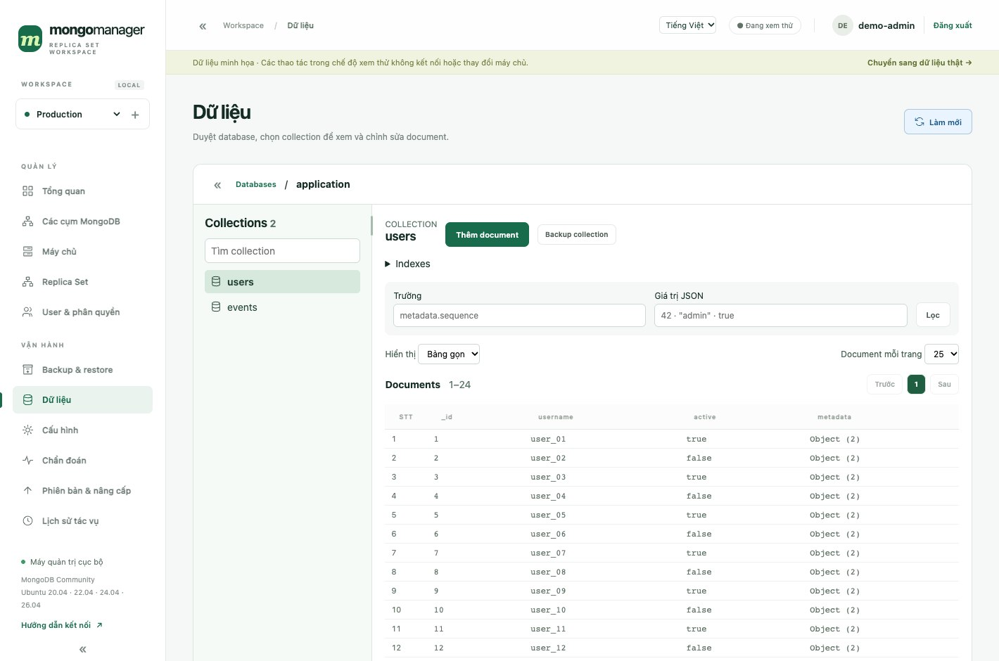

<a id="backup"></a>

## Backup và restore

**Máy lưu backup** là nơi chạy Database Tools và giữ archive tại `/var/backups/mongodb-manager`. **Đích restore** là MongoDB nhận dữ liệu. Hai nơi này có thể nằm trên hai VPS khác nhau.

1. **Tạo bản sao.** Trong workspace nguồn, mở **Backup & restore**, chọn máy lưu và phạm vi. Có thể chọn toàn replica set kèm oplog, tất cả database ứng dụng, các database cụ thể hoặc từng collection. Các database chọn riêng được dump tuần tự.
2. **Kiểm tra bản sao.** Trong **Các bản backup**, đối chiếu ID, thời điểm, nguồn và phạm vi. Bấm **Xem dữ liệu** để duyệt collection trong archive.
3. **Khôi phục.** Bấm **Restore** trên dòng bản sao, chọn cụm đích hoặc một endpoint standalone có thể ghi. Khi chọn thay thế collection, kiểm tra kỹ database và đích nhận trước khi thực hiện.
4. **Lặp lại theo lịch.** Mở **Lịch backup**, chọn phạm vi và giờ chạy. Ví dụ cron `0 2 * * *` chạy lúc 02:00 hằng ngày theo giờ Việt Nam khi Manager đang hoạt động. **Đồng bộ ngay** tạo backup mới rồi restore một lần vào cụm độc lập.

### Đọc và kiểm chứng bản backup

Trên mỗi dòng, dùng **ID backup**, thời gian, phạm vi và tên máy lưu để nhận diện đúng bản. Hai VPS có thể cùng có thư mục `/var/backups/mongodb-manager` nhưng chứa các archive khác nhau. Nếu danh sách trống hoặc thiếu manifest, kiểm tra lại máy lưu trước khi chạy lại restore.

- **Xem dữ liệu** mở danh sách collection trong archive. Với backup một phần, nhóm **Từ bản backup khác** cho biết collection đang được đọc từ bản sao khác của cùng nguồn. Đối chiếu thời điểm trước khi dùng dữ liệu để kiểm chứng.
- **Backup lại** tạo một bản mới. **Xóa** trên dòng backup xóa bản lưu trên máy chứa archive. Cột lịch sử restore cho biết những lần Manager đã khôi phục thành công và đích nhận.
- **Restore** kiểm tra checksum trước khi ghi. Nếu gặp khóa trùng, kiểm tra đích đã có dữ liệu chưa. Với backup theo collection, Manager có thể đối chiếu BSON, cấu hình và index để nhận ra bản đã khôi phục trùng khớp. Chỉ bật thay thế collection nếu muốn bỏ nội dung hiện có ở đích.
- **Lịch backup** thuộc từng workspace. Sau khi bật, kiểm tra giờ chạy kế tiếp trên giao diện. **Tạm dừng lịch** ngừng các lượt tiếp theo. Đóng tab vẫn chạy lịch khi tiến trình Manager còn hoạt động. Lịch sử từng lượt nằm trong **Lịch sử tác vụ**.

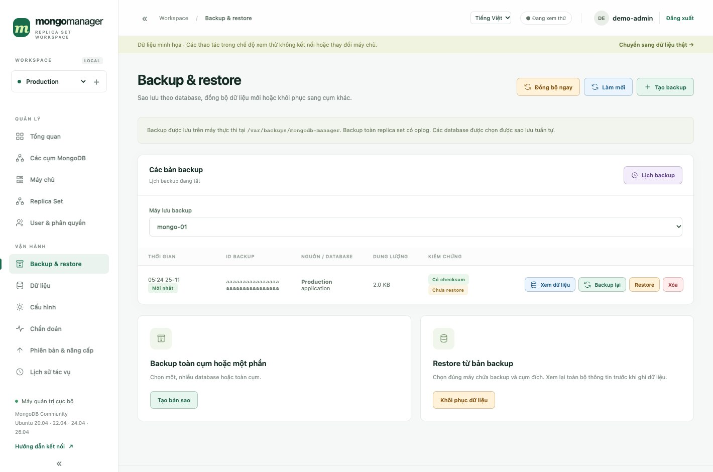

<a id="settings"></a>

## Cấu hình workspace

Mở **Cấu hình** để đối chiếu tên cụm, seed list, replica set, username, auth database và TLS. **Chuỗi kết nối** hiển thị thông tin kết nối của workspace. **Chỉnh kết nối** mở hồ sơ hiện tại. Phần **SSH cho cụm hiện tại** áp dụng thông tin SSH cho những máy được đánh dấu. Khi thêm VPS mới sau đó, cấu hình SSH cho VPS mới riêng.

Tài khoản trong **Sửa tài khoản quản trị** dùng để đăng nhập web. Khi đổi tên hoặc mật khẩu, nhập mật khẩu Manager hiện tại, lưu và đăng nhập lại. Lưu mã khôi phục mới. Có thể đổi ngôn ngữ Việt/English từ màn hình đăng nhập hoặc thanh trên cùng.

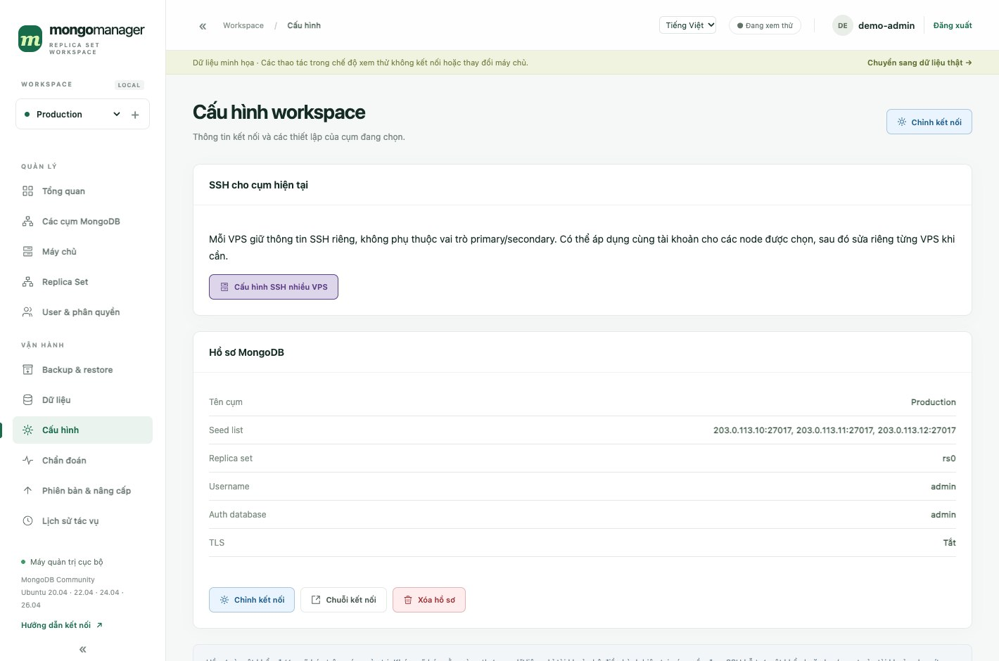

<a id="diagnostics"></a>

<details>
<summary>Kết nối SSH của các cụm và từng VPS</summary>

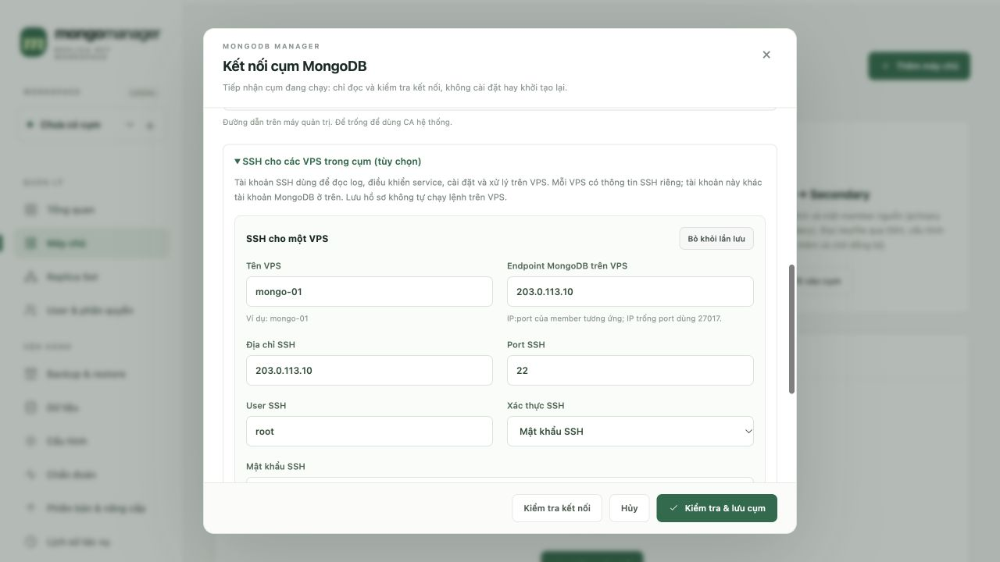

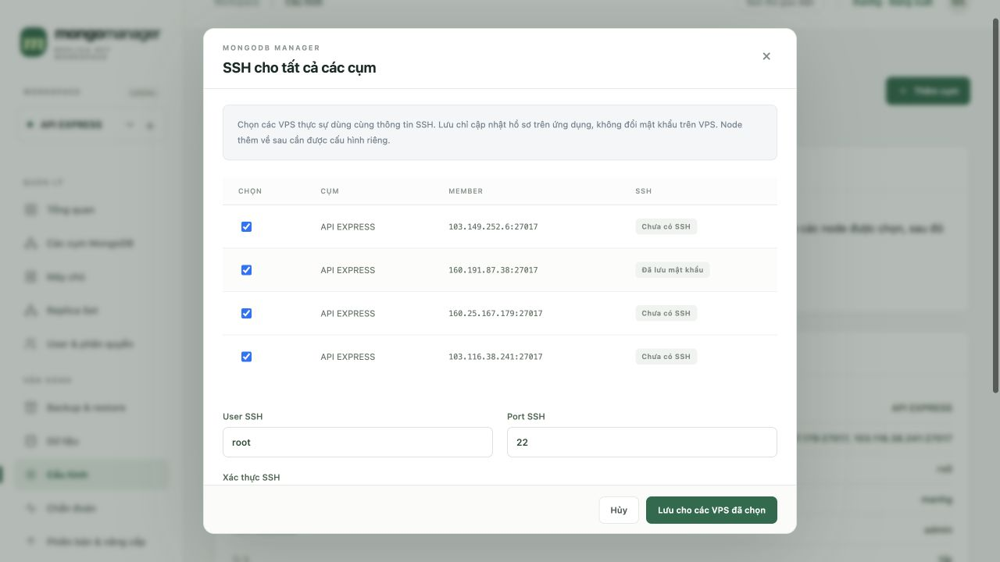

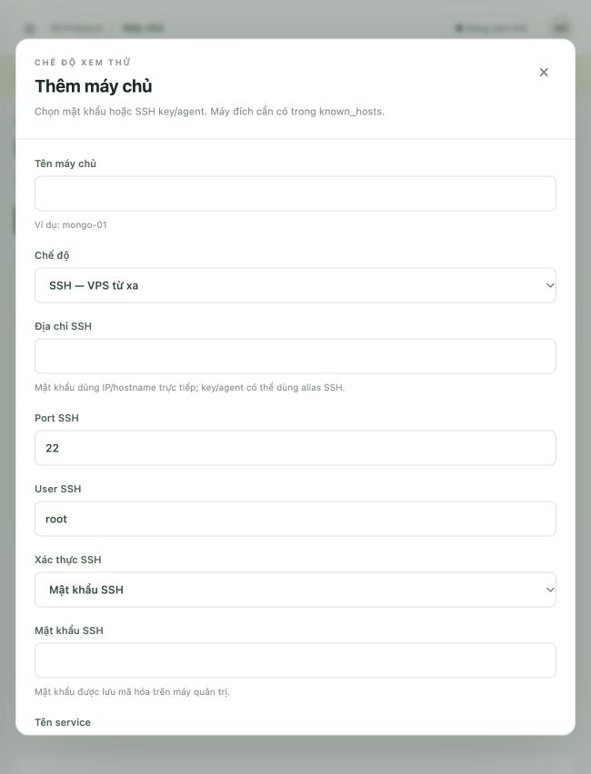

</details>

## Chẩn đoán theo triệu chứng

| Hiện tượng | Kiểm tra trong Manager |
| --- | --- |
| MongoDB chạy nhưng Manager không kết nối được | **Chẩn đoán → Kiểm tra kết nối**. Đọc kết quả theo từng endpoint. Đối chiếu IP public, cổng, TLS và database xác thực. |
| Arbiter báo giới hạn quyền đọc phiên bản | Kiểm tra vai trò qua `hello` và xem nguồn phiên bản trong bảng VPS. Phiên bản lấy từ binary trên VPS có thể vẫn đọc được qua SSH. |
| `mongod` khởi động thất bại | **Máy chủ → Dịch vụ → Chẩn đoán dịch vụ**. Xem trạng thái systemd, PID, listener và journal. Nếu MongoDB ghi file log riêng, đọc thêm đường dẫn `systemLog.path`. |
| Cổng bị chiếm khi thêm Secondary | Đối chiếu tên tiến trình, PID và địa chỉ bind. Nếu là standalone trống trên loopback, xem lựa chọn ở mục [Thêm Secondary](#secondary). |
| Keyfile sai quyền | Với instance Manager đã dừng, chọn **Sửa quyền keyfile và khởi động instance Manager**. Manager xác minh unit, cấu hình và owner trước khi đặt mode 0400 và khởi động. |
| Thiếu dung lượng hoặc có dấu hiệu lỗi WiredTiger | Kiểm tra nơi chứa dbPath và log. Giữ bản sao có thể phục hồi trước khi xử lý lưu trữ. Trang dịch vụ đưa kết quả chẩn đoán cho quản trị viên. |

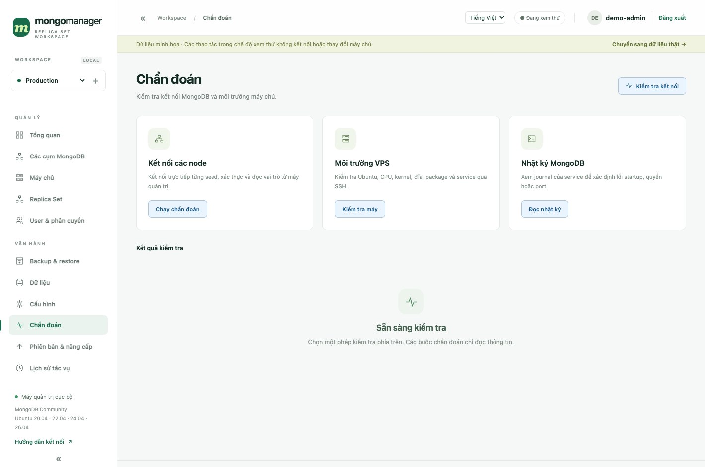

<a id="upgrade"></a>

## Kiểm tra phiên bản và nâng cấp

Vào **Phiên bản & nâng cấp**, chọn VPS và bấm **Kiểm tra lại**. Kết quả SSH và MongoDB xuất hiện theo từng phần. Đọc cột **Chi tiết** để biết phiên bản đến từ endpoint, binary trên máy hay nhánh dự định cài. Bảng cũng hiển thị mức sử dụng CPU, RAM và ổ gốc của VPS.

Ba nút **Nâng cấp Ubuntu**, **Nâng cấp MongoDB** và **Nâng cả hai** mở kế hoạch cho máy đã chọn. Trước khi nâng node chứa dữ liệu, kiểm tra quorum và chuẩn bị bản backup đã thử restore. Theo dõi bước cài gói, reboot và kiểm tra sau nâng cấp trong **Lịch sử tác vụ**.

<details>
<summary>Xem ảnh chọn VPS và ba thao tác nâng cấp</summary>


</details>

<details>
<summary>Chọn thao tác và kiểm tra phiên bản trên VPS</summary>


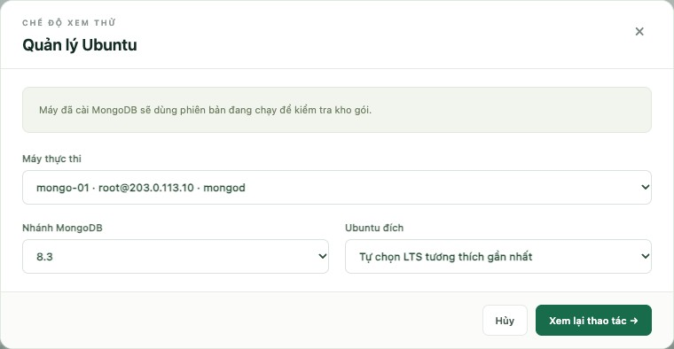

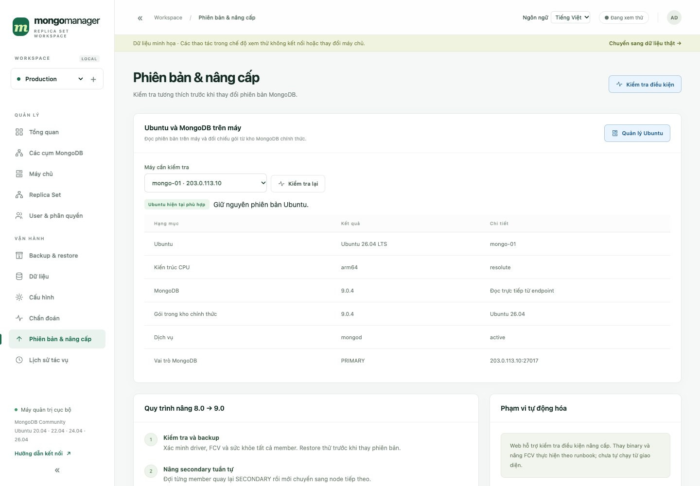

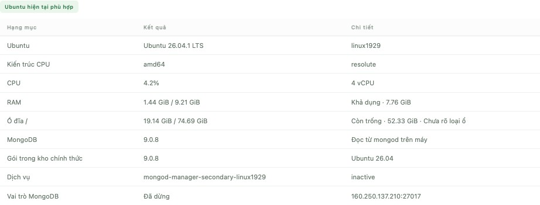

</details>

### Đọc kế hoạch trước khi nâng

**Kiểm tra điều kiện** đọc phiên bản MongoDB, FCV và sức khỏe cụm. Khi chọn **Nâng cấp Ubuntu**, xem bản hiện tại, bản đích, các chặng LTS, kiến trúc và gói MongoDB có trong kho. Khi chọn **Nâng cấp MongoDB**, kiểm tra nhánh đích, phiên bản gói, service, vai trò node và điều kiện FCV. **Nâng cả hai** dùng cho kế hoạch thay đổi cả hệ điều hành lẫn MongoDB trên VPS đang chọn. Bấm xem kế hoạch trước khi xác nhận chạy.

Trong lúc nâng Ubuntu, theo dõi gói đang xử lý và giai đoạn chờ VPS reboot. Khi máy quay lại, chạy **Kiểm tra lại** để xác minh Ubuntu, phiên bản binary, trạng thái service và vai trò MongoDB. Với nâng cả cụm, theo dõi từng node trở lại trạng thái khỏe trước khi chuyển sang node tiếp theo.

<details>
<summary>Chọn đích và xem kế hoạch Ubuntu</summary>

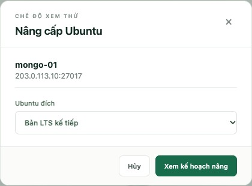

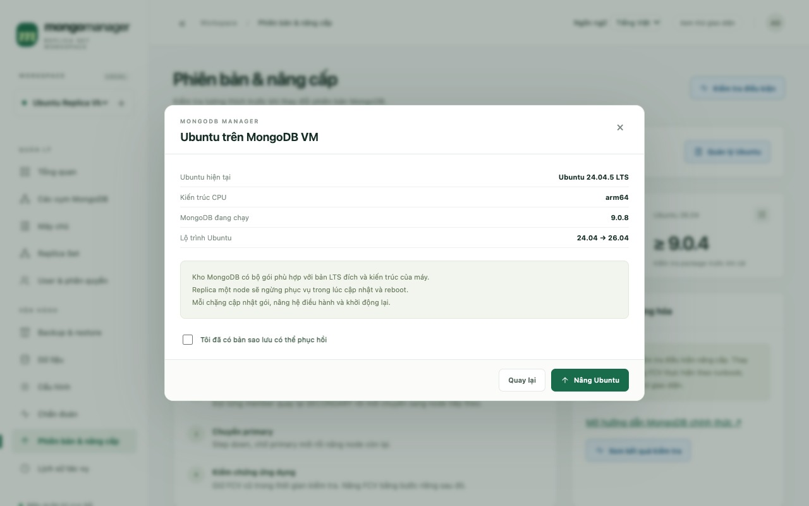

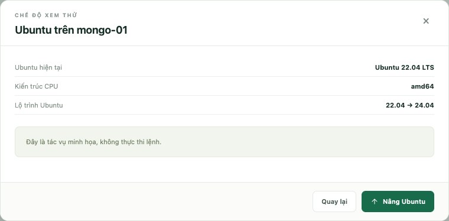

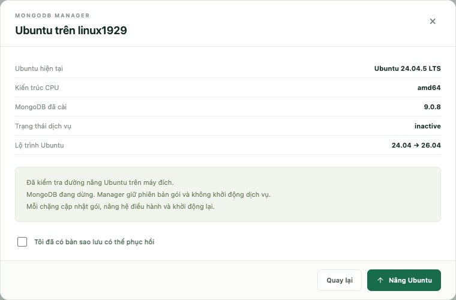

</details>

<details>
<summary>Chọn nhánh và xem kế hoạch MongoDB</summary>

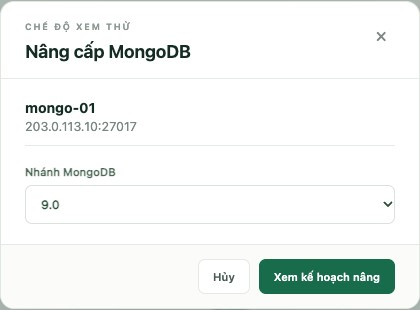

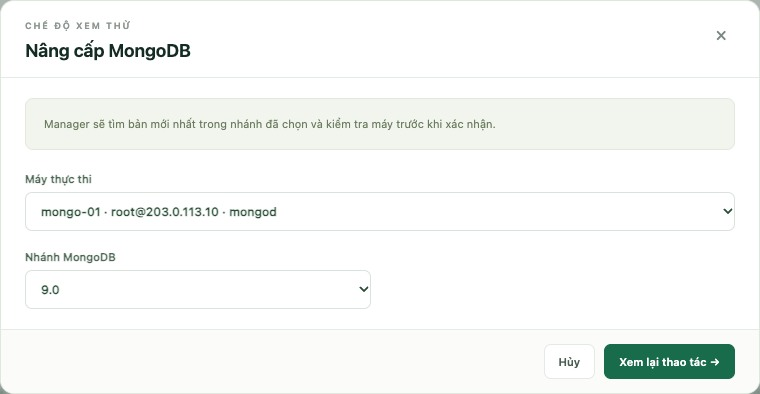

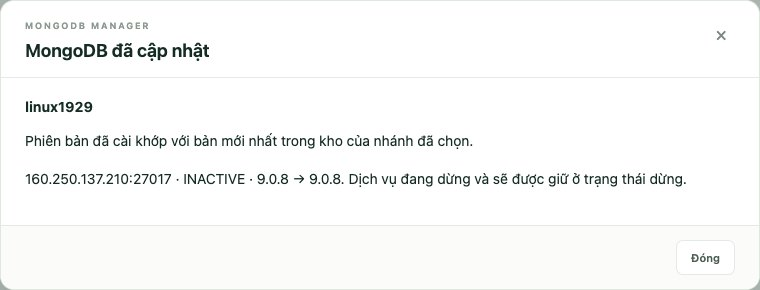

</details>

<a id="jobs"></a>

## Lịch sử tác vụ

Mở **Lịch sử tác vụ → Chi tiết** để xem tên thao tác, VPS hoặc cụm đích, thời điểm, nhật ký các bước và kết quả. Popup cập nhật trong khi tác vụ chạy. Có thể đóng popup rồi mở lại cùng tác vụ.

Nếu một thao tác đang giữ đúng VPS hoặc tài nguyên cụm mà thao tác mới cần, Manager mở nhật ký của tác vụ đang giữ tài nguyên. Công việc độc lập trên VPS khác có thể chạy song song. Sau lỗi, đọc bước cuối đã hoàn tất trước khi thử lại. Ví dụ, nếu membership đã được ghi nhưng hết thời gian chờ đồng bộ, kiểm tra node trên **Replica Set** trước khi thêm lần nữa.

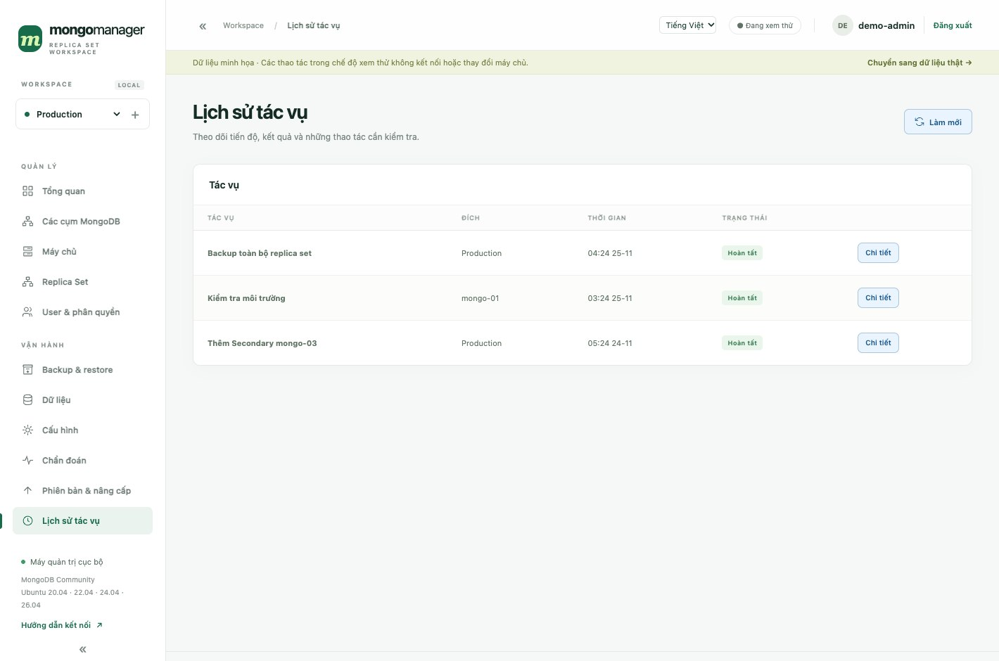

<details>
<summary>Mở lại tác vụ và theo dõi tiến độ gói</summary>

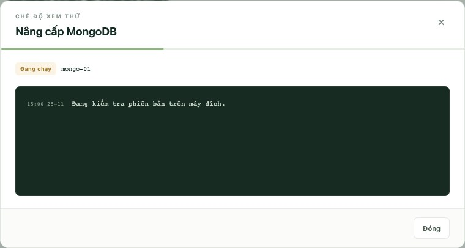

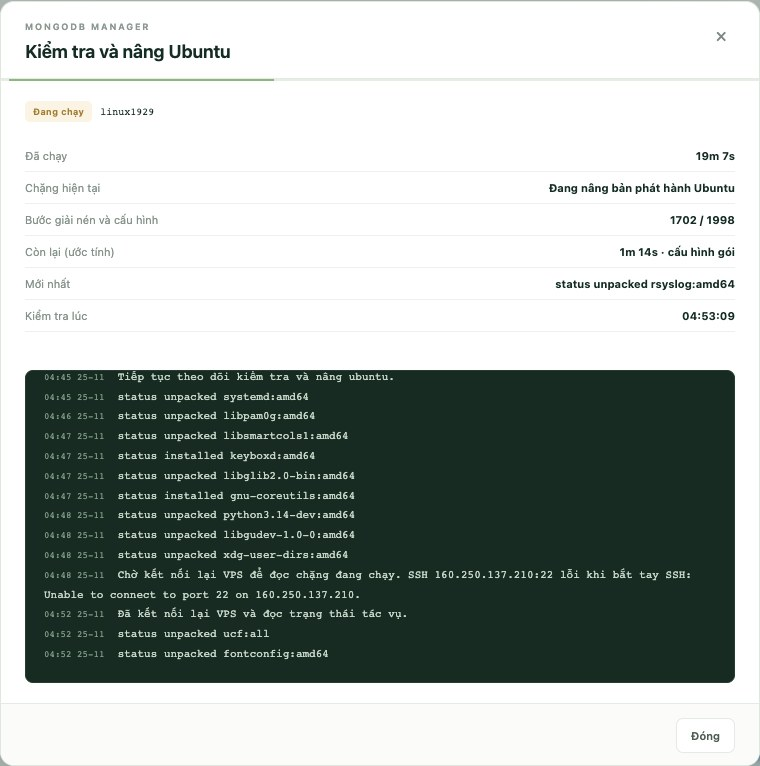

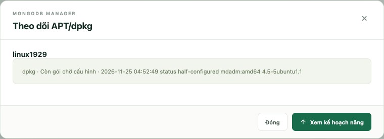

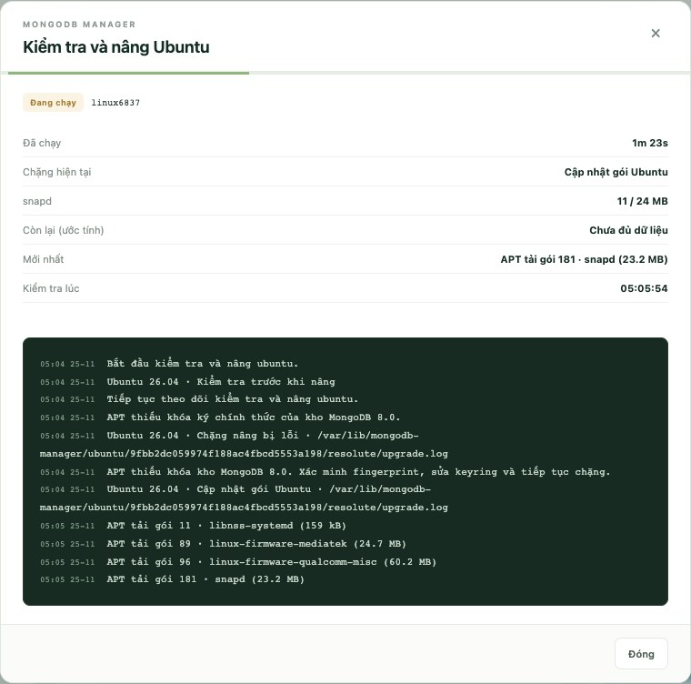

</details>

## Vận hành Manager

- **Chuyển máy quản trị.** Sao lưu toàn bộ `.web-data/`, hoặc thư mục cấu hình qua `MONGO_MANAGER_DATA`, gồm cơ sở dữ liệu và khóa mã hóa. Archive của các cụm được lưu riêng trên máy thực thi backup.
- **Đóng gói.** Chạy `bash package-web.sh` để tạo `dist/mongodb-manager-web.tar.gz`. Các bước cấu hình domain, HTTPS và service có trong [hướng dẫn triển khai](README_WEB.md).
- **Kiểm thử.** Sau khi tạo môi trường Python, chạy `.venv/bin/python -m pytest -q`. Xem [nhật ký kiểm chứng](WEB_VALIDATION.md) để biết phạm vi đã thử trên máy thật hoặc VM.
- **Dùng terminal.** Bộ script Bash bắt đầu tại [menu.sh](menu.sh). Luồng ghép node bằng dòng lệnh được mô tả trong [hướng dẫn join replica set](README_JOIN_REPLICA.md).

Trong bảng theo dõi Ubuntu, dòng **SSH** hiển thị lần thử kết nối gần nhất khi VPS tạm ngắt. Khi kết nối lại, bảng cập nhật chặng và tiến độ, còn nhật ký giữ thời điểm ngắt để đối chiếu.

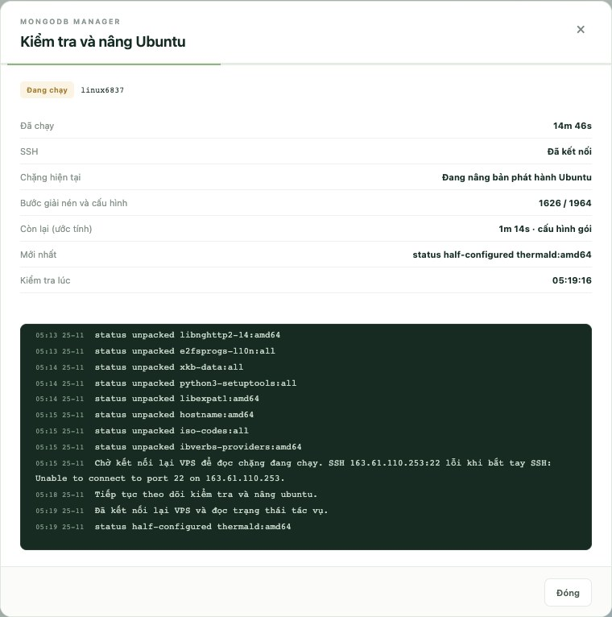

Nếu bước nâng MongoDB phát hiện VPS chưa cài mongod, bấm **Xem kế hoạch cài** để kiểm tra bản cài mới trên đúng máy và nhánh đã chọn.

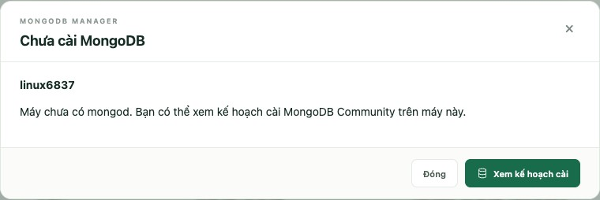

Nút **Nâng cấp MongoDB** và **Nâng cả hai** mở cả tác vụ cài mới đang chạy trên máy đã chọn. Bảng theo dõi ghi thời gian chạy, hoạt động APT/dpkg và tiến độ tải hoặc cài gói. Ước tính cho từng chặng xuất hiện khi APT đã trả đủ mẫu tiến độ.


Nếu popup kế hoạch đã mở trước lúc máy bắt đầu cài MongoDB, bấm **Xem kế hoạch** sẽ mở tác vụ đang chạy ngay cả khi APT chưa tạo dịch vụ mongod.

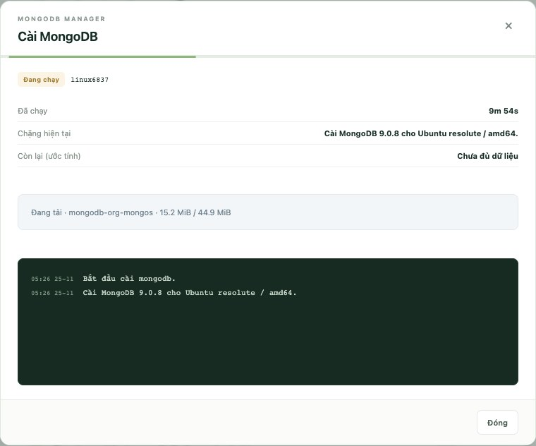

**Nâng cấp MongoDB** đọc phiên bản gói trên VPS khi unit đã bị mask và mongod đã dừng. Nếu proxy trả HTTP 502, giao diện hiển thị trạng thái kết nối tới Manager.

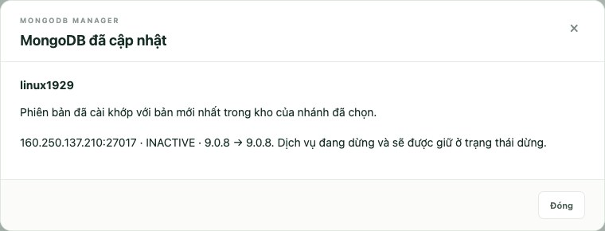

## Cập nhật tài liệu

Cập nhật mục hướng dẫn liên quan trong cùng thay đổi mã nguồn. Khi giao diện thay đổi, chụp ảnh bằng workspace minh họa, lưu trong [previews/](previews/) và dùng liên kết tương đối để GitHub hiển thị ảnh.

Trong **Thêm tên miền**, dùng **Domain bổ sung** cho các tên cùng phục vụ một website. Bấm **+ Thêm website khác** để tạo nhiều file cấu hình độc lập trên các VPS đã chọn. Mỗi website có kiểu, backend, cổng hoặc thư mục riêng. Chọn **Node.js** cho ứng dụng chạy qua cổng (Express, Next.js, Nuxt SSR), **Vue / React / Angular · SPA** cho thư mục build có `index.html`, **Web tĩnh** cho HTML thông thường. Các kiểu PHP-FPM, redirect, WebSocket, SSE và gRPC cũng có trong form. Trên từng VPS, Manager kiểm tra tên trùng, chạy `nginx -t` rồi reload một lần cho cả nhóm. [Ảnh thêm nhiều website](previews/vps-manager/nginx-create-multiple.jpg) · [Ảnh editor cấu hình](previews/vps-manager/domain-editor.jpg).

Tổng quan VPS và Software Center dùng chung bản thông tin gần nhất của từng máy, lưu trong kho dữ liệu mã hóa của Manager. Sau 5 phút, khi mở màn hình, Manager hiển thị bản đã lưu rồi đọc lại qua SSH. Nút **Làm mới** kiểm tra ngay. Trước khi xác nhận cài phần mềm, popup kiểm tra trực tiếp các máy đã chọn.

Khi thêm hoặc kiểm tra kết nối máy chủ bằng file SSH key đã nhập (`db://ssh-keys/<id>`), bộ nạp khóa ưu tiên workspace đang hoạt động và bỏ qua các store không chứa khóa thay vì báo lỗi `Không tìm thấy hồ sơ hoặc tác vụ.`.

Khi phiên đăng nhập hết hạn hoặc bị đăng xuất (`HTTP 401`, WebSocket `4401`, hoặc quay lại tab sau khi hết phiên), cả MongoDB Manager và VPS Manager đều tự chuyển về `/login` thay vì tiếp tục ở lại giao diện và báo lỗi ở các thao tác tiếp theo.

Thanh lệnh nhanh trên **SSH Terminal** có thêm nút `bench.sh` chạy `curl -Lso- bench.sh | bash`. Khi kết nối lại hoặc đóng khung terminal, socket cũ được ngắt sạch để không báo lỗi `WebSocket bị đóng trước khi kết nối (mã 1005)` đè lên phiên mới.

Các tác vụ thay đổi hệ thống/cài đặt phần mềm trên cùng một VPS được khóa theo `machine_keys` để không chạy song song nhiều job cài gói trùng nhau trên cùng máy và không tạo nhiều banner thông báo trùng lặp. Nếu người dùng F5 tải lại trang trong khi tác vụ đang chạy, giao diện tự khôi phục banner theo dõi tiến trình và thời gian đã chạy từ server.

Nhóm kit **SSL & Certbot** trong Software Center giữ gọn `certbot`, `python3-certbot-dns-cloudflare`, `openssl` và `ca-certificates`. Khi bấm **Xác nhận** trong popup (như **Copy Nginx & SSL giữa các VPS**), lỗi cũ được xóa ngay, nút hiển thị spinner xử lý và đóng popup để theo dõi tiến trình trực tiếp qua banner.

Đã bổ sung tab **SFTP** (`#sftp`) theo mô hình Termius nhiều tab, 2 khung song song (hỗ trợ chuyển đổi **Chế độ 1 khung / 2 khung**, **Đảo khung**, kéo thả/đổi kích thước khung tự do, phóng to từng khung và chế độ toàn màn hình), duyệt thư mục, ẩn/hiện file ẩn, tìm kiếm/sắp xếp, kéo-thả upload với tiến trình, tải xuống file lẻ hoặc `.tar.gz`, truyền file giữa các khung VPS hoặc **Local (máy hiện tại)**, `chmod` trực quan, sửa file text trong popup và nút mở nhanh **SFTP** từ từng khung **SSH Terminal**. [Ảnh SFTP 2 khung](previews/vps-manager/sftp-dual-pane.png).

Khi mở port trong **Firewall**, ngoài UFW và Oracle Cloud, Manager tự động xử lý rule `REJECT --reject-with icmp-host-prohibited` mặc định trên `iptables` (hoặc chèn rule `ACCEPT` trước `REJECT` nếu UFW đang tắt và lưu `netfilter-persistent`) để port thông ngay từ bên ngoài.

Khi **Copy Nginx & SSL giữa các VPS**, `nginx-import` tự kiểm tra Nginx trên VPS đích và tự tạo thư mục `sites-available`, `sites-enabled` hoặc `conf.d` nếu chưa có trước khi ghi file. Nút **Reload Nginx** cũng hỗ trợ chọn một hoặc nhiều VPS (hoặc **Chọn tất cả**) để chạy `nginx -t && systemctl reload nginx` hàng loạt.

Trang `/login` đặt timeout 12 giây khi kiểm tra `/api/auth/status` để không bị kẹt vô hạn ở dòng `Đang kiểm tra phiên đăng nhập…` nếu máy chủ hoặc kết nối qua proxy phản hồi chậm.

Trên `/vps/`, `overviewPage` dùng chung một bộ đếm `_vpsMetricsTimer` (10 giây, tự dừng sau 2 lỗi liên tiếp) để tránh rò rỉ `setInterval` gọi `/metrics` qua SSH trùng lặp, và không tự chạy `?refresh=true` quét toàn bộ gói khi mở tab **Tổng quan VPS** (chỉ quét nền khi mở **Software Center** hoặc bấm **Làm mới**).

Mục **Máy chủ** ở cả MongoDB Manager (nút **Gán cụm** cạnh **Lấy tên từ VPS**, nút **Copy IP VPS** có icon và ô tìm kiếm máy chủ) và VPS Manager (nút **Copy IP VPS** có icon và **+ Thêm từ Seed list** nền trắng đồng bộ, nút **Gán cụm** đặt cạnh ô tìm kiếm trong **Danh sách máy chủ**, hiển thị đồng bộ tên cụm MongoDB trên từng máy) mở popup chọn máy chủ (có tìm kiếm, lọc theo trạng thái/cụm, đổi cụm trực tiếp từng dòng hoặc tick nhiều máy để **gán hàng loạt**, giới hạn hiển thị 100 mục/lượt và chỉ lưu các máy có thay đổi) mà không làm đổi bố cục bảng hay form máy chủ. Bảng danh sách máy chủ ở cả hai bên đều phân trang `25 / 50 / 100` dòng mỗi trang để tải nhanh khi có hàng nghìn VPS. Popup **Token Cloudflare cho các VPS** mặc định chỉ chọn VPS hiện tại (có sẵn ô **Chọn tất cả** khi cần áp dụng hàng loạt).
