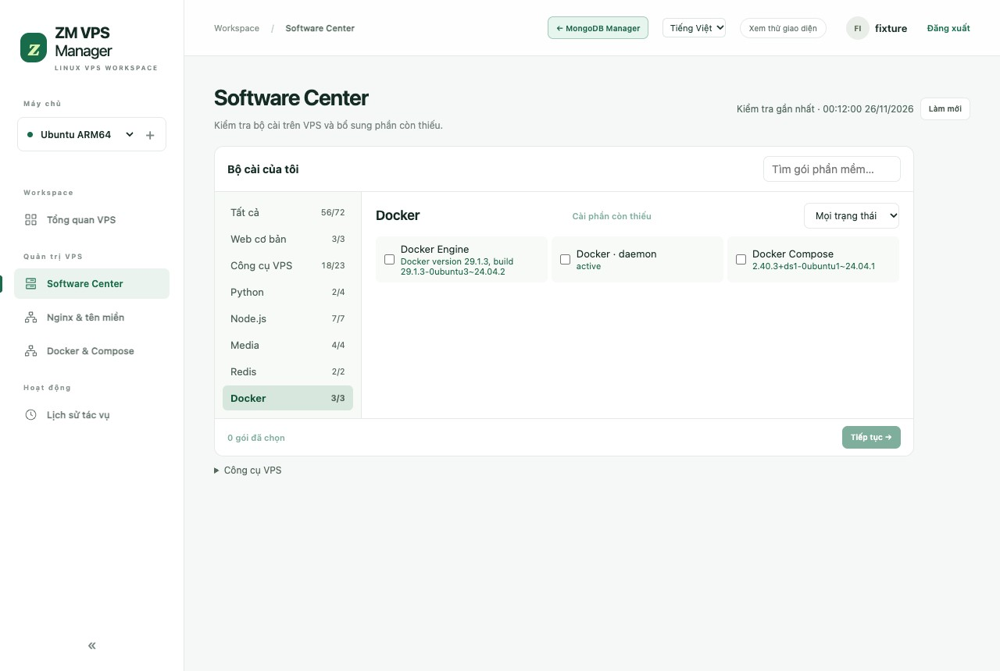
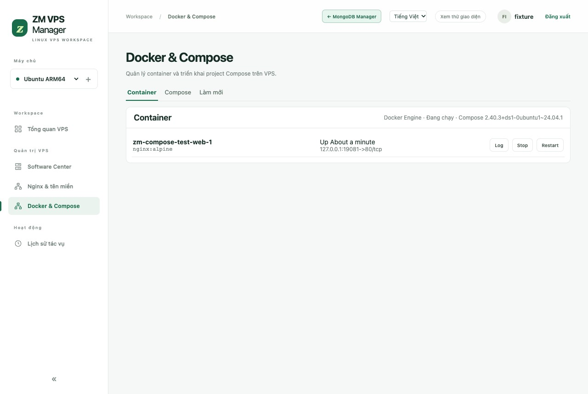

# ZM VPS Manager

Nhấn **ZM VPS Manager ↗** trên thanh trên cùng để mở giao diện VPS. Nút **← MongoDB Manager** đưa bạn về màn hình trước. Chọn VPS hiện có hoặc thêm máy qua SSH/local. Tài khoản SSH cần có khóa máy chủ đã xác minh trong known_hosts của user chạy web. Tác vụ đặc quyền qua SSH dùng root hoặc sudo không tương tác.

- **Tổng quan VPS** đọc OS, kiến trúc, CPU, RAM, ổ đĩa và trạng thái Nginx trực tiếp trên máy.
- **Software Center** gộp chung 4 tab **Bộ cài của tôi**, **Dịch vụ**, **Gói hệ điều hành** và **Kho phần mềm** cùng nút **Bảo trì gói** ngay trên thanh công cụ. Tab **Dịch vụ** đọc `systemctl` (trạng thái chạy, tự khởi động, RAM, PID) để bật/tắt/khởi động lại dịch vụ không thiết yếu, đồng thời khóa thao tác dừng/vô hiệu hóa với các dịch vụ hệ thống quan trọng (SSH, systemd, mạng). `manifests/kits.json` quy định 10 bộ cài; các gói chỉ đóng vai trò phụ thuộc nội bộ được đánh dấu `hidden` trong `manifests/install.json` để danh sách **Tất cả** gọn hơn nhưng vẫn tự động cài kèm khi cần. Mở **Tổng quan VPS → Tài khoản & SSH** để đặt mật khẩu Linux hoặc cấu hình SSH password.
- **Docker & Compose** quản lý container, triển khai file Compose và đóng gói/di chuyển toàn bộ VPS qua 1 file `.tar.gz` duy nhất. Xem chi tiết tại mục [Docker & Compose](#docker--compose). [Container trên VM Ubuntu](../../../previews/vps-manager/docker-containers.jpg).
- **Firewall** hợp nhất UFW và Oracle Cloud Firewall (OCI SDK, xác thực API Key hoặc Instance Principal). Xem [README chính](../../../README.md) để biết quyền IAM và cách mở port đồng thời hai lớp.
- **Nginx & tên miền** đọc các site do Manager tạo trên VPS. Thêm domain với cổng localhost hoặc chọn ứng dụng PM2 có biến PORT. Mỗi site có thao tác sửa cổng, bật, tắt, xóa và cấp SSL. Tắt site chuyển cấu hình từ `/etc/nginx/conf.d/` sang `/etc/nginx/zm-disabled/`. Manager lưu bản sao cấu hình vào `/etc/nginx/zm-backups/`, kiểm tra `nginx -t`, reload và khôi phục cấu hình khi áp dụng thất bại. Xóa site giữ lại chứng chỉ trên VPS.
- **Cấp SSL** cần cài Certbot và plugin trong Software Center. Chọn plugin Nginx cho HTTP-01 khi tên miền trỏ về VPS và cổng 80 truy cập được từ Internet. Chọn plugin Cloudflare cho DNS-01, nhập email và token có quyền `Zone:DNS:Edit` cho zone đó. Plugin dùng tệp `/etc/letsencrypt/zm-credentials/<domain>.ini` (quyền 0600) trên VPS để gia hạn. Sau khi cấp thành công, site phục vụ cả HTTP và HTTPS, đồng thời Manager tự động kích hoạt lịch tự gia hạn SSL có giãn cách thời gian ngẫu nhiên giữa các VPS (`RandomizedDelaySec` trên `certbot.timer`/`certbot-renew.timer`/`snap.certbot.renew.timer`, hoặc giờ/phút ngẫu nhiên + độ trễ `0–15` phút trong `/etc/cron.d/zm-certbot-renew`) để tránh nhiều VPS gia hạn cùng một thời điểm. Nút **Thử gia hạn** chạy Certbot dry-run cho đúng chứng chỉ (kể cả site đã có sẵn trên VPS). Dải trạng thái **Tự gia hạn SSL** và tab **SSL** của từng website hiển thị trạng thái tự gia hạn và nút **Bật tự gia hạn SSL** khi chưa kích hoạt. [Tài liệu Certbot Cloudflare](https://certbot-dns-cloudflare.readthedocs.io/en/stable/).


- **Lịch sử tác vụ** hiển thị job từ hai ứng dụng trên máy đã chọn. Mở job để đọc log và kết quả.



Chạy riêng với hai thư mục `apps/vps_manager/` và `shared/manager_core/` tại gốc checkout.

```bash
python3 -m venv .venv
.venv/bin/pip install -r apps/vps_manager/requirements.txt
.venv/bin/python -m uvicorn apps.vps_manager.backend.app:create_app --factory --host 127.0.0.1 --port 8765
.venv/bin/python -m pytest apps/vps_manager/tests
```

URL mặc định là `/vps/`. Đặt `ZM_MONGO_URL` để đổi đích chuyển sang MongoDB Manager. Khi vận hành hai tiến trình độc lập, chọn thư mục dữ liệu riêng qua `MONGO_MANAGER_DATA`. Chạy gateway để chia sẻ session và khóa tác vụ trong cùng tiến trình.

### Website đã có trên VPS

Mở **Nginx & tên miền → Chi tiết** để xem cấu hình, listener, SSL, nhật ký, chẩn đoán và lịch sử sửa file. Inventory đọc kết quả `nginx -T` cùng các thư mục site đã tắt. Khi Nginx báo lỗi, màn hình hiện thông báo kiểm tra cấu hình và tiếp tục dò file trên đĩa. Trạng thái bật cho biết cấu hình có trong chuỗi include.

Form tạo hỗ trợ static, PHP-FPM, redirect, reverse proxy, WebSocket, SSE và gRPC. Với upstream nhiều máy, phân tách đích bằng dấu phẩy, ví dụ `127.0.0.1:3000 weight=2, 127.0.0.1:3001 backup`. Có thể chọn Unix socket PHP-FPM và thêm header, gzip, cache proxy, CORS, whitelist, rate limit hoặc đường dẫn htpasswd. Khi cấp SSL cho site của Manager, nhập các tên bổ sung vào cùng chứng chỉ. Tên wildcard cần xác thực DNS Cloudflare.

Editor áp dụng theo **file**. Popup diff liệt kê các domain trong file trước khi lưu. Mở **Lịch sử thay đổi** để xem diff và khôi phục bản trước. Editor chỉnh các file site đang được include trong `sites-available` và `conf.d` có cấu trúc cấp ngoài là server/upstream. Nhật ký hiển thị phần cuối của file văn bản dưới `/var/log/nginx/`; số đếm HTTP status tính trên các dòng đang hiển thị và có thể bao gồm nhiều website chung log.


### Tài khoản Linux và SSH

Hồ sơ SSH key có thể dùng khóa mặc định hoặc đường dẫn private key thuộc tài khoản chạy Manager. Đối chiếu fingerprint hiển thị khi kiểm tra kết nối với fingerprint trong console của VPS trước khi tin cậy. User mới cần sudo không tương tác để thay đổi mật khẩu qua Manager. Tùy chọn mặc định chỉ đặt mật khẩu cho tài khoản Linux. Tùy chọn bật SSH password áp dụng cho user đã xác minh. Manager ghi nhận từng bước vào lịch sử tác vụ và vẫn dùng key cho hồ sơ.

Khi cần thay đổi chính sách SSH, worker sao lưu sshd_config dưới /run/zm-manager-ssh, đặt timer rollback 150 giây và kiểm tra chính sách trước khi reload. Manager mở phiên mới bằng key và mật khẩu để xác minh. Nếu mất kết nối ở bước này, xem trạng thái lại sau thời hạn rollback. Mật khẩu Linux vừa đặt vẫn có hiệu lực khi cấu hình SSH được phục hồi.


### Danh mục cài đặt

Mục **Bộ cài của tôi** đọc tên hiển thị, nhóm, tên gói theo APT/DNF và hướng dẫn cài từ manifest của ứng dụng. Nhập tên gói hoặc chọn nhóm để lọc. Bộ cài là lựa chọn ban đầu, có thể bỏ hoặc thêm từng mục trước khi xác nhận.

| Nhóm | Thành phần |
|---|---|
| Công cụ VPS | GCC, G++, Make, Git, curl, wget, unzip, zip, Vim, tmux, jq, rsync |
| Giám sát và mạng | htop, btop, ncdu, vnStat, net-tools, dnsutils, iputils-ping, lsof, cron, netcat, logrotate, Speedtest CLI, Bench.sh |
| Python và Go | Python 3, pip, venv, lệnh python, pip/setuptools/wheel trong venv, Go từ kho hệ điều hành hoặc PPA longsleep của Ubuntu |
| Node.js | NVM, Node LTS và npm, Bun, Yarn, fast-cli, NSS, ALSA, PM2, PM2 startup/save, PM2 Logrotate 100M/3 bản/nén |
| Media | FFmpeg, libavcodec-extra, aria2, yt-dlp stable/nightly và timer cập nhật nightly lúc 08:00 theo múi giờ VPS |
| Web, SSL và bảo mật | Nginx, UFW, Fail2ban, OpenSSL, CA certificates, Certbot qua kho gói/Snap/venv, plugin Nginx/Apache/Cloudflare và timer gia hạn |
| Database và thiết lập | Redis, bật dịch vụ Redis/Nginx/vnStat/cron/Fail2ban, múi giờ Asia/Ho_Chi_Minh |

**Tài khoản cài đặt.** NVM, Node, npm global, Bun, PM2, Bench.sh và Python venv của người dùng chạy dưới user của hồ sơ SSH. Venv ở `~/.venvs/zm-vps`. Hai bản yt-dlp có tên `yt-dlp` và `yt-dlp-nightly` trong `/usr/local/bin`. Bench.sh được tải về `~/.local/bin/bench.sh` để chạy khi cần đo hiệu năng. Bộ cài kiểm tra từng dependency và phiên bản sau khi cài. Trên Ubuntu, thư viện âm thanh tự chọn tên gói có trong kho, gồm `libasound2` hoặc `libasound2t64`.

**Bảo trì gói.** Chọn VPS, mở popup bảo trì và xác nhận thao tác cập nhật danh mục, nâng các gói hệ thống, làm mới CA hoặc cài lại OpenSSL và CA. Giao diện **Nginx & tên miền** quản lý cấu hình website và chứng chỉ. Thao tác mở port, sửa DNS, swap, TCP/nofile và xóa dữ liệu được tách khỏi bộ cài phần mềm.

## Git & SSH Key

Chọn VPS rồi mở **Git & SSH Key**. **Cài công cụ / Cập nhật** sử dụng kho APT đã cấu hình để cài hoặc nâng `git` và `openssh-client`. **Sửa danh tính** ghi Git Username và Git Email vào cấu hình global của user Linux đang kết nối.

- **+ Tạo SSH key** tạo ED25519 mặc định hoặc RSA 4096-bit. Có thể nhập email và passphrase. Private key nằm trên VPS, thư mục SSH dùng quyền `0700` và private key dùng `0600`. Manager từ chối tên file đã tồn tại.
- Danh sách đọc các file public key `~/.ssh/*.pub`. Với private key thiếu file `.pub`, chọn **Tạo lại public key** rồi nhập passphrase nếu có. **Nhập public key** lưu một public key độc lập. Để xác thực Git, VPS cần có private key tương ứng. Bấm **Public key → Sao chép**, sau đó mở **GitHub Keys ↗** hoặc trang SSH keys của GitLab/Bitbucket để đăng ký.
- **+ Alias** gắn một host, ví dụ `github-work`, với provider và key đã chọn trong `~/.ssh/config`. Dùng `git clone git@github-work:nhom/project.git` hoặc đặt remote URL dùng alias đó. Các alias dùng agent riêng qua `IdentityAgent`. Key mới tự nạp vào agent. Sau reboot, chọn **Nạp vào agent** và nhập lại passphrase nếu có.
- **Kiểm tra kết nối** dùng key đã chọn và đối chiếu host key ED25519 trước khi xác thực qua cổng 22. Nếu provider đổi fingerprint, cập nhật giá trị đã đối chiếu với tài liệu của họ. [GitHub](https://docs.github.com/en/authentication/connecting-to-github-with-ssh/testing-your-ssh-connection) · [GitLab](https://docs.gitlab.com/user/gitlab_com/) · [Bitbucket](https://support.atlassian.com/bitbucket-cloud/docs/configure-ssh-and-two-step-verification/).
- **Gỡ alias** giữ lại file key. **Xóa key** yêu cầu xác nhận, gỡ key khỏi agent của Manager, xóa các file của key và alias do Manager quản lý trên VPS. Việc thu hồi public key đã đăng ký ở nhà cung cấp Git thực hiện trong tài khoản của nhà cung cấp.
- **Lịch sử tác vụ** hiển thị từng bước, kết quả và lỗi. Passphrase chỉ được chuyển đến worker để thực hiện tác vụ.


## Docker & Compose

Mục **Docker & Compose** hỗ trợ cả người **chưa dùng Docker** (chỉ muốn gom toàn bộ project PM2, Nginx, SSL và MongoDB để chuyển sang VPS mới) lẫn người **đã dùng Docker / Docker Compose**.

- Nếu VPS chưa có Docker, bấm nút **Cài đặt Docker** ở góc phải để mở **Software Center → Bộ Docker** (`docker-engine`, `docker-service`, `docker-compose`).
- Bấm **Làm mới** ở góc phải để đọc lại trạng thái Docker Engine, phiên bản Compose và danh sách container.

### 1. Đóng gói & Di chuyển (Portable Stack — Tab mặc định)

Dùng khi bạn muốn **gom mọi thứ đang chạy trên VPS cũ thành 1 file `.tar.gz` duy nhất**, sau đó **tải lên 1 lần** để tự động dựng lại y hệt trên bất kỳ VPS mới nào (kể cả VPS trắng chưa cài gì).

**Bước A — Đóng gói VPS cũ thành 1 file:**
1. Chọn VPS nguồn ở thanh chọn máy chủ phía trên.
2. Mở **Docker & Compose → Đóng gói & Di chuyển**; hệ thống tự quét và liệt kê:
   - **PM2 Apps**: Các ứng dụng Node.js/backend đang chạy dưới PM2 (tự loại bỏ `node_modules`, `.git`, `.venv`, file `.log` để gói nhẹ và gọn, giữ nguyên code và `.env`).
   - **Docker Compose**: Các project Compose đang chạy trên VPS.
   - **Nginx & SSL**: Các file cấu hình website trong `/etc/nginx/` và chứng chỉ SSL trong `/etc/letsencrypt/live/`.
   - **MongoDB**: Dữ liệu toàn bộ database ứng dụng qua `mongodump --gzip` (nhập **MongoDB URI** nếu MongoDB có bật mật khẩu xác thực).
3. Tích chọn các thành phần muốn gom rồi bấm **Đóng gói thành 1 file (.tar.gz)** và xác nhận trong popup. Gói hoàn thành sẽ xuất hiện ở mục **Gói đã lưu trên Manager** và có nút **Tải về** máy cá nhân.

**Bước B — Tải lên & chạy trên VPS mới:**
1. Chuyển máy chủ ở thanh chọn phía trên sang **VPS mới** (hoặc tải file `.tar.gz` từ máy cá nhân lên bằng nút **Tải lên gói (.tar.gz)**).
2. Bấm **Triển khai lên VPS này** trên dòng gói tương ứng, kiểm tra lại danh sách ứng dụng/domain/MongoDB trong popup và chọn các tùy chọn tự động:
   - **Tự động cài phần mềm còn thiếu**: Cài Nginx, Node.js/PM2, Docker & Compose hoặc `mongodb-database-tools` nếu VPS mới chưa có.
   - **Khôi phục dữ liệu MongoDB**: Chạy `mongorestore --gzip` (tích `--drop` nếu muốn xóa collection cũ trước khi nạp).
   - **Khôi phục & khởi chạy ứng dụng**: Giải nén code, tự chạy `npm install --omit=dev` (nếu thiếu `node_modules`), khởi động lại PM2 (`pm2 save`) và chạy `docker compose up -d --build`.
   - **Khôi phục cấu hình Nginx & SSL**: Ghi file Nginx + chứng chỉ SSL, chạy `nginx -t` (tự rollback nếu lỗi) rồi reload Nginx.
   - **Mở port 80, 443 trên UFW**: Tự động mở HTTP/HTTPS nếu tường lửa UFW đang bật.

> [!NOTE]
> Nếu bạn muốn dựng **MongoDB Replica Set** đầy đủ trên VPS mới trước khi nạp dữ liệu, hãy tạo cụm trong **MongoDB Manager → VPS mới → Cụm mới** trước, sau đó chạy bước triển khai gói ở trên.

### 2. Container

Hiển thị toàn bộ container hiện có trên VPS (`docker ps --all`) gồm tên, image, trạng thái và cổng đang mở:
- Bấm **Log** để xem 200 dòng nhật ký gần nhất.
- Bấm **Start**, **Stop** hoặc **Restart** và xác nhận trong popup để điều khiển container. Mọi thao tác đều được ghi vào **Lịch sử tác vụ**.

### 3. Compose

Dùng để chạy hoặc cập nhật một project đã có file `compose.yaml` / `compose.yml` nằm sẵn trên VPS:
1. Nhập **đường dẫn tuyệt đối** đến file Compose trên VPS (ví dụ `/opt/app/compose.yaml`).
2. Tích **Tải image mới trước khi triển khai** nếu muốn chạy `docker compose pull` trước khi `up -d`.
3. Bấm **Kiểm tra cấu hình**: Manager chạy `docker compose config` để xác thực cú pháp, hiển thị tên project và danh sách service/image trong popup xác nhận (ẩn các biến môi trường nhạy cảm) trước khi chạy `docker compose up -d`.


